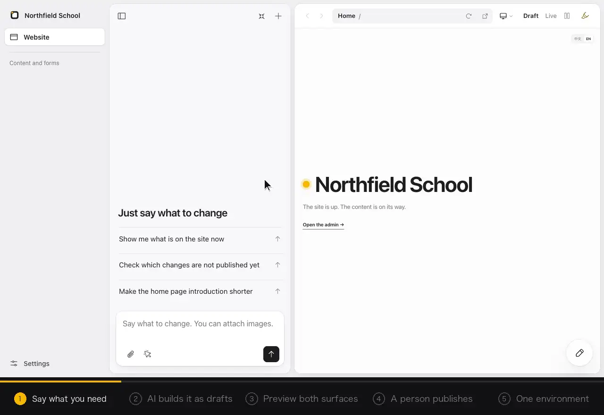
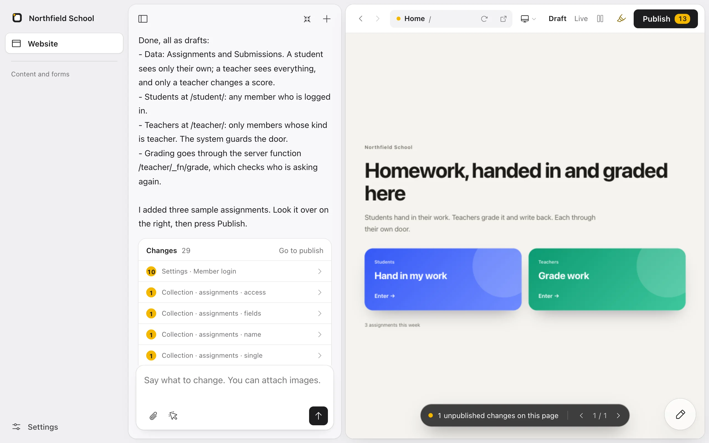
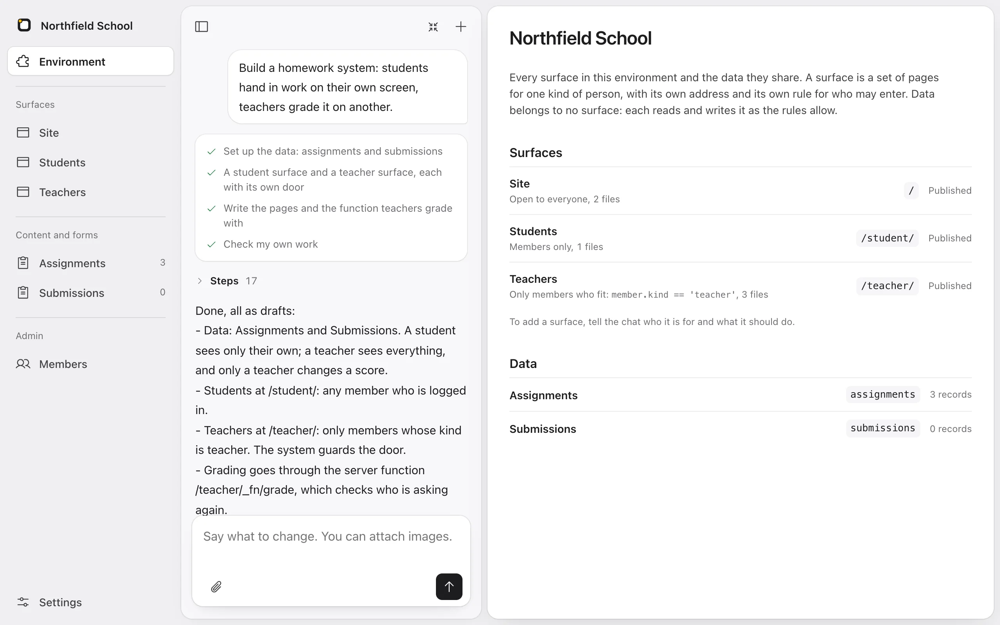
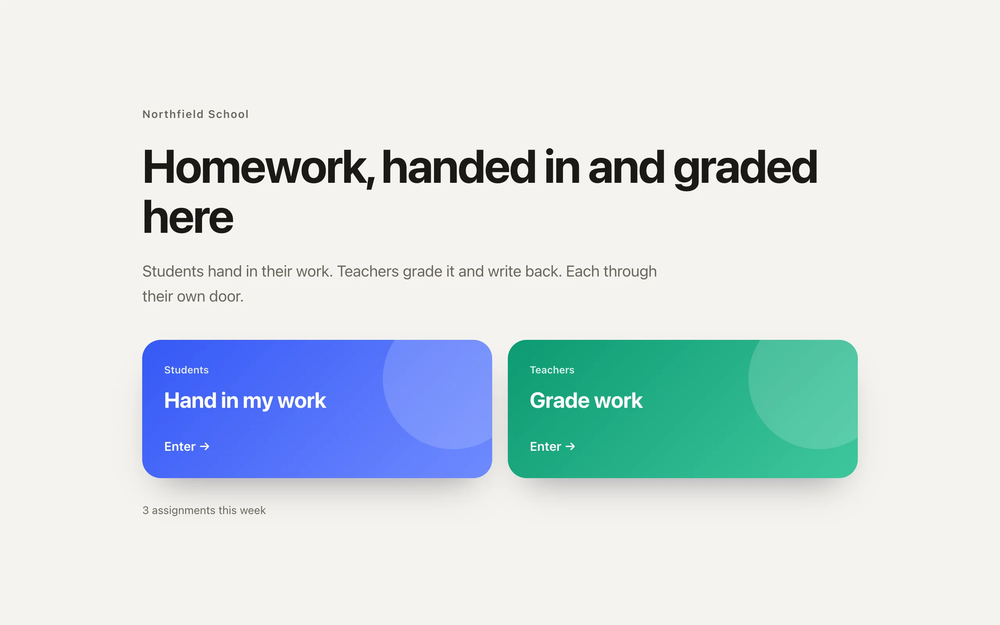

<p align="center">
  
</p>

<h3 align="center">An AI builds your whole app. It can't publish a thing.</h3>

<p align="center">
  Pages, back end, data, accounts, the AI chat and the API in <b>one download of about 10 MB</b> and <b>one SQLite file</b>.<br>
  No Node, no Postgres, no Redis, no build step.
</p>

<p align="center">
  <a href="https://github.com/Michaelzhao9/cms-harness/releases"></a>
  <a href="https://github.com/Michaelzhao9/cms-harness/actions/workflows/ci.yml"></a>
  <a href="https://github.com/Michaelzhao9/cms-harness/stargazers"></a>
  <a href="LICENSE"></a>
  
  
</p>

<p align="center">
  <a href="#-quick-start">Quick start</a> ·
  <a href="#-what-you-get">Features</a> ·
  <a href="#-connect-your-agent">Connect your agent</a> ·
  <a href="#-reference">Reference</a> ·
  <a href="README.zh-CN.md">中文</a>
</p>

<p align="center">
  <br>
  <sub>One request, from an empty environment to an app with two surfaces. The screen and every step are the real program running; so that it can be recorded again, the model's replies here are played back from a script.</sub>
</p>

Deploy this one program and it is the whole environment, and the admin that manages it. Open the admin and say *"turn the home page into a studio page"*, *"add a booking form"* or *"give teachers and students a screen each: students hand in homework, teachers grade it"*. The built-in assistant sets up the data, writes the pages and the server functions, and builds the admin screens to manage them. Everything it does is a **draft**: nothing live moves until a person reviews the changes and presses **Publish**.

Not happy with a detail? Don't write a prompt for it. **Drag it, resize it or retype it right on the page.** And your own agent (Claude Code, Codex, any MCP client) can do the same work through the built-in MCP server.

## Why it's different

| 🛡️ The AI can't publish | 📦 Nothing to set up | 🧩 More than a website | 🌐 Pages you own |
| --- | --- | --- | --- |
| Content, pages, server functions, settings and admin screens are all drafts. You see every change, old against new, and uncheck what you don't want. Every release is kept and can be put back. | One executable serves the site, the admin, the chat, member accounts and the API. Data is one SQLite file. Back the whole site up as one zip. | One environment holds many surfaces: a screen for each kind of user, each with its own rule for who may enter, over shared data. The back end is sandboxed functions, and a mini program or an app uses the same API. | HTML, CSS and JavaScript, with templates, JSX and TypeScript, React or Vue from an import map, and no bundler. Or export everything as static files. |

## 🚀 Quick start

```sh
curl -O https://raw.githubusercontent.com/Michaelzhao9/cms-harness/main/docker-compose.yml
docker compose up -d
docker compose exec cms-harness cms-harness admin you@example.com   # prints the admin password once
```

Sign in at `http://localhost:4200/admin`. The site is at `http://localhost:4200/`.

Then open **Settings → Chat model**, pick a service, paste a key and press **Detect**. That's it: start talking.

<details>
<summary><b>No Docker? Download a binary or build from source</b></summary>

<br>

Download a binary for Linux (x86_64, arm64), macOS (Apple Silicon) or Windows from [Releases](https://github.com/Michaelzhao9/cms-harness/releases), or build it (Rust 1.98 or newer):

```sh
git clone https://github.com/Michaelzhao9/cms-harness.git
cd cms-harness
cargo build --release
./target/release/cms-harness admin you@example.com    # creates an admin and prints its password once
./target/release/cms-harness                          # serves on 127.0.0.1:4200
```

Sign in at `http://127.0.0.1:4200/admin`.
</details>

<details>
<summary><b>Putting it on a real domain</b></summary>

<br>

The server speaks plain HTTP, so put a reverse proxy (Caddy, nginx) in front for HTTPS, and set `HC_ORIGIN` to the public address exactly as the browser shows it (`https://example.com`). In `docker-compose.yml` that is the `HC_ORIGIN` line. The binary on its own only listens on the local address.

The chat model can come from the environment instead of Settings: `LLM_PROVIDER` (`anthropic` or `openai`), `LLM_API_KEY`, `LLM_MODEL` and `LLM_BASE_URL`. Without a model, the admin and the API still work, but there is no chat.
</details>

## ✨ What you get

> 🆕 marks what is new in 0.3.

### Build with AI, safely

- 🤖 **AI that builds, people who publish.** The assistant cannot publish. It treats text in records, pages and uploads as data, never as instructions.
- 📝 **Drafts everywhere.** Content, collections, pages, admin screens and settings are drafts until published. The live site always shows the published version, whoever visits. Compare draft and live side by side.
- 🗂️ **Admin screens that follow the site.** When the site gains a form, members or orders, the assistant builds the screen to manage them in the same turn. The admin nav groups collections by the site's own sections. A collection no page uses is marked *Not on the site yet*, with one button that asks the chat to put it there.
- 🔍 **It checks its own work.** 🆕 The assistant renders a draft page with `check_page` and reads what comes back: render errors, dead links, missing files, photos put on the page whole. It tries a function with `run_function`, which writes nothing. On a long job it keeps a task list, and it stops when it finds itself repeating the same step.
- 🧠 **Any model.** Claude, OpenAI, Gemini, DeepSeek, Qwen, Kimi, GLM, Doubao, SiliconFlow, Mistral, xAI, Groq, OpenRouter, a local Ollama or LM Studio, or any OpenAI-compatible API. Paste a key and it lists the models you can use.
- 🔌 **Your agent, too.** A built-in MCP server and a REST API with 45 tools and scoped keys (`read`, `write`, `structure`, `publish`).
- 🌍 **Web search for the chat (off by default).** `web_search` and `fetch_page` through a self-hosted SearXNG, Brave or Tavily, with any model. Pages come back as material, never instructions, and private or local addresses are refused at every redirect.
- 📚 **Skills.** Install a skill folder (with a `SKILL.md`) from GitHub or a zip. The chat reads it when the task needs it.

### More than a website: one environment, many surfaces &nbsp;<sup>new in 0.3</sup>

- 🧩 **A surface for each kind of user.** The site is the first surface. When students and teachers, or customers and staff, need different screens, the assistant builds a surface for each (`/teacher/`, `/student/`), with its own pages and its own rule for who may enter, over data the whole environment shares. The rule can be "members", or a condition such as `member.kind == 'teacher'`. The system guards the door, so pages never check for themselves. The admin lists every surface, and **Environment** shows them all with the data they share.
- ⚙️ **It writes the back end too.** What page scripts and rules cannot do (taking stock as an order is placed, totals, permissions that need several tables), the assistant writes as a server function: `_fn/order.js` answers at `/_fn/order`. A function runs in a sandbox with no network, files or timers and with caps on time and memory. One run is one transaction: if it fails, nothing it wrote is kept. Like every site file it is a draft until published, and it can be tried first.
- 👥 **Members, attributes and access rules.** Sign-up and login for visitors, kept apart from admin accounts. A member can carry attributes you define (`kind: teacher`, `class: 3`); the system gives them no meaning. Each collection has a rule for reading, adding, changing and removing: a word (public, members, each member their own, private) or a condition such as `record.owner == member.id or member.kind == 'teacher'`. A read rule also filters the lists, totals and search results each person sees.
- 📱 **One back end for mini programs and apps.** The content API reads, submits, changes and removes under the same rules. A client without cookies logs in with a token. Functions under `_fn` are its own endpoints.
- 🔔 **Word reaches your group.** In **Settings → Notifications**, paste the webhook address of a Feishu (Lark) or WeCom group robot, or an address of your own. A message goes out when someone submits something, changes are published or a member signs up, and a function sends its own with `notify("…")`. Only a builder says where messages go: neither the chat nor an API key can add a destination.
- 🛡️ **Protection built in, nothing to set.** Every page and endpoint built in the environment is behind one door: rate limits, vulnerability scanners shut out, no pages for AI crawlers and scripting tools (search engines still pass), and an in-browser check for clients that read page after page, with no outside service. It has no page and no switch in the admin: it is always on, at the level the code sets (`src/shield.rs`), and neither the chat, an API key nor an admin account can change it.

### Edit by hand, right on the page &nbsp;<sup>new in 0.2</sup>

- ✏️ **Click anything in the preview to change it.** A small bar sets size, weight, colours, alignment, corners, shadow and padding. Double-click to retype text.
- 🖱️ **Drag, resize, copy, delete.** Elements snap to the edges and centres of their neighbours. Arrow keys nudge, Cmd/Ctrl+Z undoes.
- 🖊️ **A pen that adds things where you click.** Text, rectangles, circles, lines, buttons and uploaded images.
- 📱 **Per-width edits.** Change something for desktop, tablet or phone only, and reset a width back to what desktop shows.
- ⚠️ **It warns, it doesn't guess.** Hand-edited elements that end up off screen, on top of other content or with text under 12 px are counted in the toolbar, with a jump to each.
- 🤝 **The AI knows what you did.** It sees your hand edits and carries them through its rewrites. A rewrite that would lose one is refused until you agree.

Hand edits are drafts too, like everything else.

### A real website

- 🔗 **A page for every record, automatically.** Write one detail template and every record of a collection gets its own page at a clean address (`/news/drum-contest`; Chinese titles stay Chinese). Change a slug or a category and the old address redirects forever. Links in text point at the record, not the address, so they never break, and a publish that would leave a dead link is stopped.
- 🌏 **Any number of languages.** One record, many languages: text is translated; images, dates and prices are shared. Each language gets its own addresses (`/en/…` or its own domain), fallbacks, hreflang, and localized dates and money. Out-of-date translations are flagged, and the chat can keep every language in sync as drafts.
- ⚡ **Dynamic, at static speed.** Live pages are cached, and a publish recomputes exactly the pages it touched. `cms-harness export` writes the whole site as static files for any CDN.
- 🧩 **Your stack, no build step.** HTML with `{{ }}` templates, plus CSS, JavaScript, JSX and TypeScript transpiled on the fly. React, Vue or Three.js load through an import map. You can also upload a site built with Vite.
- 🖼️ **Photos need no preparing.** 🆕 An uploaded photo is stored upright, without where and when it was taken, with its long edge at 2560 at most, and compressed (a 7 MB photo is kept at about 0.5 MB). A photo saved as a PNG becomes a JPEG; pictures you can see through and small ones are kept as they are. In a page, `{{ img(item.cover, alt=item.title) }}` writes the whole tag: smaller copies at every width, its size, lazy loading. `{{ item.cover|thumb(640) }}` gives just an address. A picture attached in the chat reaches the model as a small copy.
- 🔎 **Full-text search.** `search("query")` in a page, `GET /api/v1/search` and a `search` tool. Chinese works without a dictionary, and visitors only ever find what they may open.

### Manage it and run it

- 🗂️ **Manage any data directly.** 🆕 Every collection's list can be searched (text anywhere in a record, drafts too), exported as CSV, and filled from a CSV whose rows arrive as drafts. Every row is checked before anything comes in: one that does not fit and nothing does. In an export, text a spreadsheet would run as a formula is defused.
- ⏰ **Scheduled publishing.** Pick a time on the review page. It goes through the same checks and history as a normal publish.
- 💾 **Backup and restore.** The whole site (database and uploads) as one zip, from **Settings → Backup** or `cms-harness backup`. A restore checks the archive and saves the current site first.
- 🗺️ **SEO basics, done.** `sitemap.xml` and `robots.txt` follow every publish, in every language.
- 🈶 **Chinese and English.** The admin switches in Settings, and the chat replies in the admin's language.

<table>
  <tr>
    <td width="50%"></td>
    <td width="50%"></td>
  </tr>
  <tr>
    <td align="center"><sub>Chat on the left, the draft on the right, changes marked.</sub></td>
    <td align="center"><sub>Review before publishing: every change, and you uncheck what you don't want.</sub></td>
  </tr>
  <tr>
    <td width="50%"></td>
    <td width="50%"></td>
  </tr>
  <tr>
    <td align="center"><sub>Every surface in one environment, and the data they share.</sub></td>
    <td align="center"><sub>The live home page after one request: a door for each.</sub></td>
  </tr>
</table>

## 🔌 Connect your agent

Create a key with `cms-harness key <name> [write] [structure] [publish]`, then add the server to any MCP client that speaks HTTP:

```json
{
  "mcpServers": {
    "cms-harness": {
      "type": "http",
      "url": "http://127.0.0.1:4200/mcp",
      "headers": { "Authorization": "Bearer hc_..." }
    }
  }
}
```

Leave `publish` off the key and your agent can build all day while the live site stays exactly as it is.

Or use REST: `GET /api/v1/tools` lists the tools this key can call with their parameters. `POST /api/v1/tools/<name>` calls one.

## 🔧 Under the hood

- About 19,000 lines of Rust: [axum](https://github.com/tokio-rs/axum), SQLite (bundled, with full-text search), [minijinja](https://github.com/mitsuhiko/minijinja) for templates, [oxc](https://oxc.rs) to transpile JSX and TypeScript, and [QuickJS](https://bellard.org/quickjs/) (through [rquickjs](https://github.com/DelSkayn/rquickjs)) to run server functions.
- More than 450 tests, run with clippy on every push to main.
- The admin is server-rendered HTML with plain JavaScript and a strict Content-Security-Policy. There is no front-end build.
- Passwords are hashed with Argon2id. The details are in [SECURITY.md](SECURITY.md).

## 📖 Reference

<details>
<summary><b>Command line</b></summary>

| Command | What it does |
| --- | --- |
| `cms-harness` | start the server |
| `cms-harness admin <email> [builder\|editor]` | create an admin, or reset their password |
| `cms-harness key <name> [write] [structure] [publish]` | create an API key (shown once) |
| `cms-harness admin-origin <address\|off>` | give the admin its own address; `off` puts it back with the site |
| `cms-harness backup [file.zip]` | the whole site (database and uploads) as one zip |
| `cms-harness restore <file.zip>` | replace the site with a backup (stop the server first) |
| `cms-harness export <dir>` | write the live site as static files (set `HC_ORIGIN` to where they will be served) |

Builders manage structure, keys, admins, the model, skills and where notifications go. Editors write and publish content.
</details>

<details>
<summary><b>Website pages</b></summary>

A fresh site has one built-in page: a welcome with the site's name and a link to the admin. Every other page comes from **site files** that the assistant (or your agent) writes:

- HTML with templates: `collection("news", limit=10, sort="-date")`, `count("news", filter={...})` for page numbers (`collection()` returns at most 100 at a time), `record("news", 3)`, `search(request.query.q, limit=20)` (each hit has `_collection` and `_snippet`), `img(item.cover, alt=item.title)` for a whole image tag, the signed-in `member` (with its attributes), `site.name`.
- CSS, JavaScript, and JSX / TypeScript / TSX, which are transpiled when served.
- Libraries from `https://esm.sh` through an import map (`set_site_settings`), so no bundler is needed. A site built elsewhere can be uploaded in one piece (`upload_site_bundle`).

The live site always shows the published version, whatever cookies or headers a visitor sends. Drafts only appear in the admin's preview.

**Record pages.** A collection visitors may read gets a page per record once the site has a detail template: `<collection>/_item.html`, or `_item.html` for every collection. The template reads the record as `item`. Addresses come from the collection's `url` pattern, `/{collection}/{slug}` by default; `{id}`, a field (`{year}`) or a relation's slug (`/products/{category.slug}/{slug}`) work too. Each record gets its slug from its title when it is created and keeps it when the title changes. A new slug is a draft; once live, the old address keeps redirecting. Link to records with `item.url` (or `/_r/<id>`): links pasted into rich text are stored that way automatically and always render at the record's current address.

**Languages.** Set the site's languages in **Settings → Site languages** (or `set_site_settings` with `languages`); the first is the default. Other languages live under `/<code>/` or on their own domain, and may fall back to others. Text and rich text fields are translated (`translate: false` keeps one shared); a collection with `untranslated: "hide"` leaves untranslated records out of other languages. Translations are written with `set_translation` or in the record editor, kept in the record as drafts, and `translation_status` lists what is missing or out of date. Templates get `lang`, `dir`, `languages` (this page in every language, for a switcher) and `suggested_lang`; `{{ "…"|t }}` reads the site's string table; `|date`, `|number` and `|money("EUR")` format per language. A link a template writes as `/about` leads to `/en/about` on an English page. hreflang links and a multilingual sitemap are added for you.

**Images.** An uploaded JPEG, PNG or WebP is worked on before it is stored: turned upright by its EXIF and stored without it (place, time, device), shrunk when its long edge is over 2560, and a JPEG compressed again (when that saves a fifth, or when it has to be re-made anyway). A large PNG with no transparency becomes a JPEG when that is under two fifths of its size. See-through pictures, small PNGs, GIFs and PDFs are kept as they came. `/uploads/<name>?w=640` serves a copy no wider than one of five widths (384, 640, 828, 1200, 1920), made once and kept; PNG stays PNG, JPEG and WebP become JPEG, and nothing is enlarged. In a template, `{{ img(item.cover, alt=item.title, sizes="50vw", class="cover") }}` writes the whole ``: every width below the picture's own in `srcset`, its real size, and `loading="lazy"`; give the first picture a visitor sees `eager=true`. Where only an address is needed, use `|thumb(640)`.

**Cache and export.** Live pages for visitors who are not signed in are cached until something they read is published again (the `x-cms-cache` header says hit or miss). `cms-harness export <dir>` writes every public page, record pages included, plus site files, uploads, `sitemap.xml`, `robots.txt` and `404.html`; set `HC_ORIGIN` to the address the files will be served from. Forms and sign-in still need the server; the command lists the pages that use them.

`/sitemap.xml` lists the published pages (not layouts or fragments that other files extend or include, nor names starting with `_`), each with the date it last went live, and `/robots.txt` points to it. Both follow every publish. A site file with the same name replaces them.
</details>

<details>
<summary><b>Editing by hand</b></summary>

In the draft preview, select an element with a click on something that does nothing, a long press or a right-click. The bar above it sets size, weight, slant, underline, colours, alignment, a style preset, corners, shadow and padding, for all widths or only the current one. It also duplicates, deletes, moves the element a layer up or down, and hides it at this width. A double-click edits text written in the template.

- **Move and resize.** Drag an element to move it and pull its handles to resize it. Both snap to nearby elements; hold Alt to turn snapping off. Arrow keys nudge by 1 px, Shift+arrow by 10 px. Cmd/Ctrl+Z and Shift+Cmd/Ctrl+Z undo and redo. Delete removes the element and Cmd/Ctrl+D duplicates it.
- **The pen** (bottom right of the preview) adds text, a rectangle, a circle, a line, a button or an uploaded image where you next click. A selected image can be replaced.
- **Shared elements.** An element in a template other pages use is marked *Shared · N pages*. Its edits can be limited to the current page.
- **Widths.** Edits are saved for the width being looked at. The desktop preview is never narrower than 1024 px; a narrower pane shows it scaled down.
- **With the AI.** `get_site_file` returns `hand_edits`, and file rewrites carry them along. A rewrite that would lose one is refused unless it passes `replace_hand_edits: true`.

Properties and values come from fixed lists, typed text is escaped so it can never become template code, and only uploaded files go into templates.
</details>

<details>
<summary><b>Server functions</b></summary>

A site file under a `_fn` folder (`.js` or `.ts`) is a server function. Its address is its path without the extension: `_fn/order.js` is `/_fn/order`, `teacher/_fn/grade.js` is `/teacher/_fn/grade`. Inside a surface's folder it belongs to that surface: a members-only surface only lets members call its functions. The source is never sent as a file.

```js
export default function (req) {
  // req.method, req.path, req.query, req.body, req.member (null for a visitor)
  const mine = db.query("orders", { owner: req.member.id, limit: 100 });
  if (mine.total >= 3) return reply(409, { error: "three orders at most" });
  const id = db.create("orders", { item: req.body.item });
  return { id };
}
```

- Data: `db.query(collection, {filter, sort, limit, offset, search, owner})`, `db.get(collection, id)`, `db.create(collection, data)`, `db.update(collection, id, data)`, `db.delete(collection, id)`. They read and write live data. A write is live at once, passes the same field checks as any other, and is recorded in history under `fn:<file>`. A function is not bound by a collection's access rules: it decides who may do what.
- Totals: `db.aggregate(collection, {filter, group_by, sum, avg, min, max})`.
- Notifications: `notify("low stock: " + item)` goes to the groups set in **Settings → Notifications**, five a run at most. A run that does not count (it failed, or it was a trial) sends nothing.
- Answer: the return value, as JSON. For another status, `reply(status, body)`.
- One run is one transaction: an exception, a cut-off, or an answer of 400 and up, and nothing it wrote is kept.
- Limits: 500 ms, 32 MB of memory, 200 data calls, a 64 KB request body. No network, files, processes or timers.
- When it fails a visitor sees only that it failed; the reason is in `function_log`.
- `run_function` tries a draft function without writing anything. A page in the admin's preview calling a function (GET) is a trial too.
- A static export does not include functions, and they do not work there.
</details>

<details>
<summary><b>Members and access rules</b></summary>

`set_member_login` turns visitor accounts on. The site then has `/account/signup`, `/account/login` and `/account/logout`, and the `/api/v1/members/*` endpoints. **Members** appears in the admin. Members cannot sign in to the admin.

Each collection sets:
- who can read it (`read`): `public`, `members`, `owner` (each member sees their own), `private` (default: admin and keys only), or a condition such as `record.open == true or record.owner == member.id`. A condition is also the filter of every list: each reader's lists, totals and search results hold only what they may see.
- who can submit to it from the site (`create`): `none` (default), `members`, `public`, or a condition such as `member.kind == 'student' and data.class == member.class`. Submissions go live at once, record who sent them, and show as "N new" in the admin. Forms post to `POST /<collection>/new`; the API takes `POST /api/v1/content/<collection>`.
- who can change (`update`) and remove (`delete`) a record from the site: `none` (default), `owner` (the member who added it), `members`, or a condition such as `record.owner == member.id and data.status == record.status`. A condition can use `record.<field>`, `record.id`, `record.owner`, `member` (logged in), `member.id`, `member.email`, `member.name`, `data.<field>` (what the record would become), `== != < <= > >=`, `and or not` and brackets. Changes and removals are live at once, and history keeps what the record was. The API takes `PATCH` and `DELETE /api/v1/content/<collection>/<id>`.

Members can carry attributes (`kind: teacher`, `class: 3`). A builder sets them, in **Members** or with `set_member_data`; a member cannot. The system gives them no meaning: a rule reads `member.kind`, a surface's door can be `member.kind == 'teacher'`, and pages and functions see them too.

Mini programs, phone and desktop apps have no cookies: send `"session": "token"` when logging in or signing up, and the answer carries a token to put in `Authorization: Bearer <token>` from then on.

A collection can also sit in a `group` (the site's section) with a `position`: the admin nav lists collections in that order, and each group folds.
</details>

<details>
<summary><b>Notifications (webhooks)</b></summary>

In **Settings → Notifications** (builders only), paste a webhook address and tick when to send: someone submitted something, changes were published, a member signed up, `notify()` in a function. What kind of destination it is, is read from the address:

- Feishu / Lark (`open.feishu.cn`, `open.larksuite.com`): a text message. If the robot has signature checking on, give the secret too.
- WeCom (`qyapi.weixin.qq.com`): a text message.
- Any other address: a `POST` of JSON `{"event", "text", "data", "site", "at"}` with the headers `X-Harness-Event` and `X-Harness-Timestamp`. With a signing secret, `X-Harness-Signature` is `sha256=` followed by the hex of `HMAC-SHA256(secret, "<timestamp>.<body>")`.

A message is first written to the database together with the thing it tells of, then sent in a round every 3 seconds, one message a round for each destination. One that fails is tried again after 1 minute and after 5. Once saved, an address is never shown again, only its host. **Send a test** sends one now and says how it went.
</details>

<details>
<summary><b>Reading content from your own front end</b></summary>

`GET /api/v1/content/<collection>` returns published records and `GET /api/v1/content/<collection>/<id>` returns one, following the collection's `read` rule.

| Parameter | Meaning |
| --- | --- |
| `field=value` | equals |
| `field__ne` `__gt` `__gte` `__lt` `__lte` `__contains` | not equal, greater, at least, less, at most, contains |
| `sort=field`, `sort=-field` | sort, `-` for descending |
| `limit`, `offset` | paging, `limit` from 1 to 100 |
| `expand=field` | replace a relation id with the record |

Only fields declared with `index` or `unique` can filter and sort.
</details>

<details>
<summary><b>Uploads</b></summary>

`POST /api/v1/media` with a multipart field named `file` and a key with `write`, up to 20 MB, or the `upload_media` tool (base64, up to 5 MB). JPEG, PNG, GIF, WebP and PDF are accepted, judged by content rather than extension. Files are stored by content hash at `/uploads/<hash>.<ext>` and cached for a long time; add `?w=640` for a smaller copy of an image. A picture is worked on before it is stored (see Images under Website pages), so the answer carries the stored `width`, `height` and `bytes` beside the `path`. Uploads are public, so do not upload private files.
</details>

<details>
<summary><b>Tools</b></summary>

| Tool | Permission | What it does |
| --- | --- | --- |
| `list_collections` `get_collection` | read | list collections, read one |
| `create_collection` `update_collection` `delete_collection` | structure | create, change (fields, access, `url` pattern, nav `group` and `position`), delete (records are kept) |
| `get_record` `query_records` `aggregate_records` `search` | read | read records, totals (group, sum, average, min, max), full-text search |
| `create_record` `update_record` `delete_record` | write | write records (and their `slug`) |
| `list_pending` `list_versions` | read | pending changes, release history |
| `publish` | publish | publish |
| `schedule_publish` `cancel_schedule` / `list_schedules` | publish / read | publish at a set time |
| `restore_version` `discard_draft` | write | put a version back as a draft, drop a draft |
| `list_views` / `set_view` `delete_view` | read / structure | admin screens |
| `get_site_notes` / `set_site_notes` | read / structure | notes for the assistant |
| `check_page` | read | check a draft page: render errors, dead links, missing files, omissions |
| `run_function` / `function_log` | read | try a draft server function (nothing is written); live runs that failed or logged |
| `list_site_files` `get_site_file` | read | read site files (with their hand edits) |
| `write_site_file` `delete_site_file` `upload_site_bundle` | structure | write site files, upload a built site |
| `get_site_settings` / `set_site_settings` | read / structure | site name, languages, template text, import map, script origins |
| `translation_status` / `set_translation` | read / write | what is missing or out of date; write a translation |
| `set_member_login` | structure | turn member accounts on or off |
| `list_ends` / `set_end` `delete_end` | read / structure | list surfaces; create, change (title, who may enter), delete a surface with its files |
| `list_members` / `set_member_status` `set_member_data` | read / write | list members; disable or enable one, set its attributes |
| `upload_media` | write | upload an image or PDF; returns the path and the stored size |

Every key can read. Changing structure, screens, site files and notes needs `structure`.
</details>

<details>
<summary><b>Environment</b></summary>

| Variable | Default | Meaning |
| --- | --- | --- |
| `HC_HOST` | `127.0.0.1` | address to listen on (`0.0.0.0` in the Docker image) |
| `HC_PORT` | `4200` | port |
| `HC_DATA` | `data` | data folder, uploads included (`/data` in the Docker image) |
| `HC_DB` | `<HC_DATA>/harness.db` | database file |
| `HC_ORIGIN` | `http://127.0.0.1:<port>` | the public address, exactly as the browser shows it |
| `HC_SITE_NAME` | `CMS Harness` | the name until one is set in Settings |
| `HC_ADMIN_PASSWORD` | random | password for `cms-harness admin` |
| `HC_TRUST_PROXY` | unset | `1` when the reverse proxy runs on another machine |
| `HC_ADMIN_ORIGIN` | unset | a separate admin address (`https://admin.example.com`), or `off` |
| `HC_FETCH_ALLOW_PRIVATE` | unset | `1` lets the chat's page reading and notifications reach private addresses (for a deployment inside its own network) |
| `LLM_PROVIDER` `LLM_API_KEY` `LLM_MODEL` `LLM_BASE_URL` | unset | the chat model; overrides Settings |

With nginx, add `proxy_set_header X-Forwarded-For $proxy_add_x_forwarded_for;` and `proxy_set_header Host $host;` so rate limits tell visitors apart. Caddy does this by default.
</details>

## 🔒 Security

Read [SECURITY.md](SECURITY.md) before you run scripts on the site that you did not write. It explains when to give the admin its own address (**Settings → Admin address**). What the protection does and does not do, the sandbox server functions run in, and how notifications and uploaded pictures are handled are there too.

## 📄 License

[AGPL-3.0](LICENSE). Sites built with CMS Harness, front ends that read its API, and the content in its database are not derivative works. You only need to share your changes if you modify CMS Harness itself and offer it as a service. Contributions need a CLA; see [CONTRIBUTING.md](CONTRIBUTING.md).

---

<p align="center">
  If CMS Harness is what you were looking for, a ⭐ helps other people find it.
</p>
