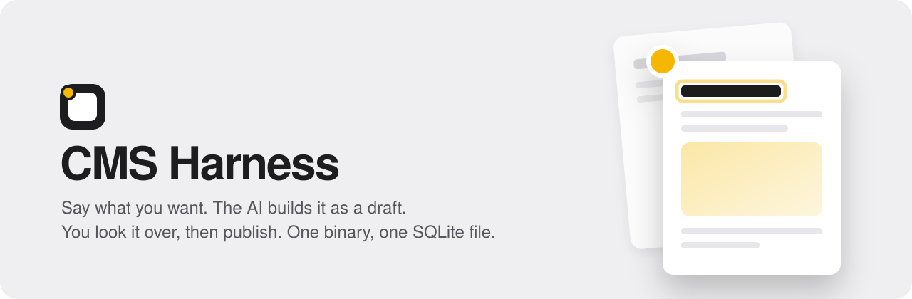
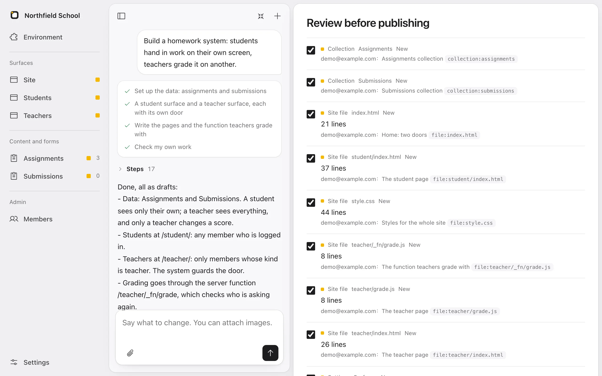
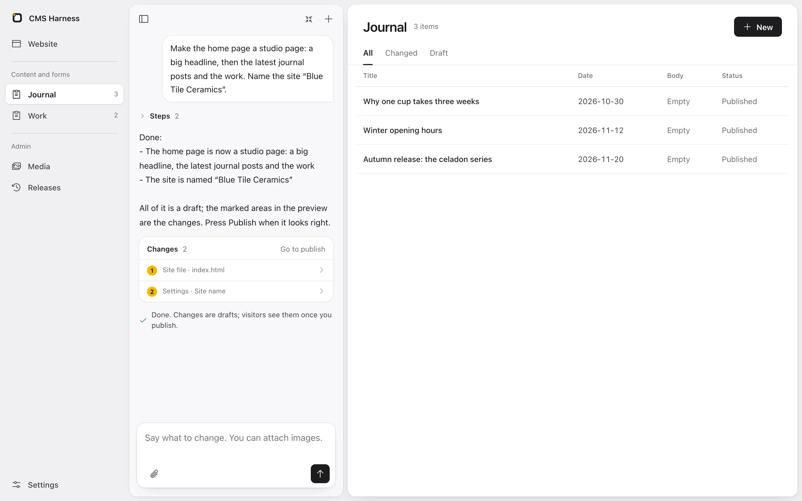
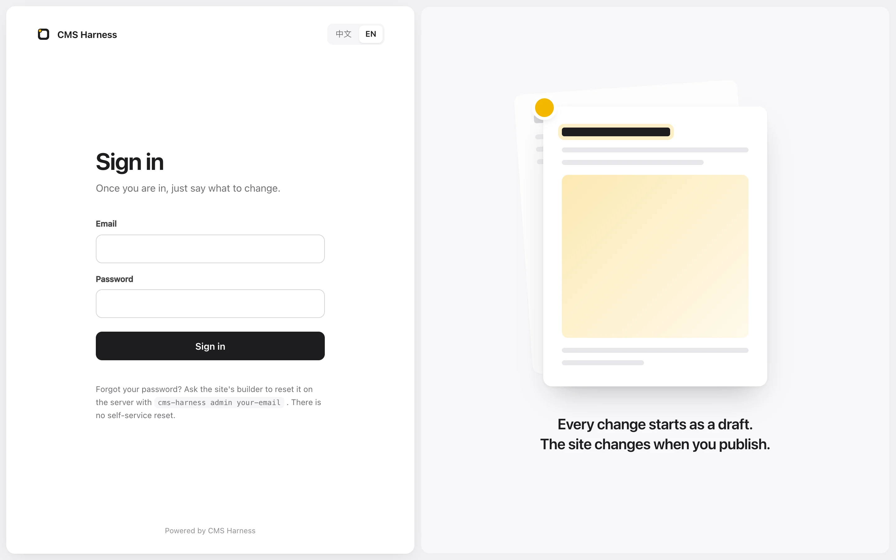

<p align="center">
  
</p>

<p align="center">
  <a href="LICENSE"></a>
  
  
  
  
</p>

<p align="center"><b>English</b> · <a href="README.zh-CN.md">中文</a></p>

**CMS Harness is a website and its admin in one Rust binary, built to be run by AI.** Open the admin and say *"turn the home page into a studio page"*, *"add a booking form"* or *"let visitors sign up"*. The built-in assistant changes the content, the pages and the admin screens. Every change is a draft until a person presses **Publish**. Your own agent (Claude Code, Codex or any MCP client) can do the same work through the built-in MCP server.

It needs no external services. One executable and one SQLite file serve the public site, the admin, the chat, member accounts and the API.

<p align="center">
  
</p>

## How it works

| 1. Say it | 2. Look at the draft | 3. Publish |
| --- | --- | --- |
| Type what you want in the chat, or pick elements in the preview and ask about them. | The assistant writes content, pages and admin screens as **drafts**. The preview marks each change; the live site does not move. | Review the list, uncheck what you don't want, publish. Every release is kept and can be restored. |

## What you get

- **AI that builds, people who publish.** The assistant cannot publish. It treats text in records, pages and uploads as data, never as instructions.
- **Drafts everywhere.** Content, collections, pages, admin screens and settings are drafts until published. The live site always shows the published version, whoever visits.
- **A real website.** Pages are HTML with `{{ }}` templates, plus CSS, JavaScript, JSX and TypeScript (transpiled on the fly). React, Vue or Three.js load through an import map, with no build step. You can also upload a site built with Vite.
- **Admin screens that follow the site.** When the site gains a form, members or orders, the assistant builds the screen to manage them in the same turn. When the feature goes, the screen goes too. Turn on member login and **Members** appears by itself.
- **Members and access rules.** Sign-up and login for visitors, kept apart from admin accounts. Each collection says who can read it (public, members, each member their own, private) and who can submit to it.
- **Any model.** Claude, OpenAI, Gemini, DeepSeek, Qwen, Kimi, GLM, Doubao, SiliconFlow, Mistral, xAI, Groq, OpenRouter, a local Ollama or LM Studio, or any OpenAI-compatible API. Paste a key and it lists the models you can use.
- **Skills.** Install a skill folder (with a `SKILL.md`) from GitHub or a zip. The chat reads it when the task needs it.
- **Your agent, too.** A built-in MCP server and a REST API with scoped keys (`read`, `write`, `structure`, `publish`).
- **Full-text search.** `search("query")` in a page, `GET /api/v1/search` and a `search` tool. Chinese works without a dictionary, and visitors only ever find what they may open.
- **Chinese and English.** The admin switches in Settings. The chat replies in the admin's language. Built-in pages follow the visitor's browser, and have a 中文 / EN switch.

<table>
  <tr>
    <td width="50%"></td>
    <td width="50%"></td>
  </tr>
  <tr>
    <td align="center"><sub>Review before publishing: every change, old against new.</sub></td>
    <td align="center"><sub>Content tables the assistant builds and keeps in step with the site.</sub></td>
  </tr>
  <tr>
    <td width="50%"></td>
    <td width="50%"></td>
  </tr>
  <tr>
    <td align="center"><sub>The admin sign-in.</sub></td>
    <td align="center"><sub>A fresh deploy: one page, until you ask for more.</sub></td>
  </tr>
</table>

## Quick start

You need Rust 1.85 or newer.

```sh
git clone https://github.com/Michaelzhao9/cms-harness.git
cd cms-harness
cargo build --release
./target/release/cms-harness admin you@example.com    # creates an admin and prints its password once
./target/release/cms-harness                          # serves on 127.0.0.1:4200
```

Sign in at `http://127.0.0.1:4200/admin`. The site is at `http://127.0.0.1:4200/`.

To use the chat, open **Settings → Chat model**, pick a service, paste a key and press **Detect**. You can also set `LLM_PROVIDER` (`anthropic` or `openai`), `LLM_API_KEY`, `LLM_MODEL` and `LLM_BASE_URL` in the environment. Without a model, the admin and the API still work, but there is no chat.

To serve the site publicly, put a reverse proxy (nginx, Caddy) in front for HTTPS. The server only listens on the local address. Set `HC_ORIGIN` to the public address.

## Connect your agent

Create a key with `cms-harness key <name> [write] [structure] [publish]`, then add the server to any MCP client that speaks HTTP:

```json
{
  "mcpServers": {
    "cms-harness": {
      "type": "http",
      "url": "http://127.0.0.1:4200/mcp",
      "headers": { "Authorization": "Bearer hc_..." }
    }
  }
}
```

Or use REST: `GET /api/v1/tools` lists the tools this key can call with their parameters. `POST /api/v1/tools/<name>` calls one.

## Reference

<details>
<summary><b>Website pages</b></summary>

A fresh site has one built-in page: a welcome with the site's name and a link to the admin. Every other page comes from **site files** that the assistant (or your agent) writes:

- HTML with templates: `collection("news", limit=10, sort="-date")`, `record("news", 3)`, `search(request.query.q, limit=20)` (each hit has `_collection` and `_snippet`), the signed-in `member`, `site.name`.
- CSS, JavaScript, and JSX / TypeScript / TSX, which are transpiled when served.
- Libraries from `https://esm.sh` through an import map (`set_site_settings`), so no bundler is needed. A site built elsewhere can be uploaded in one piece (`upload_site_bundle`).

The live site always shows the published version, whatever cookies or headers a visitor sends. Drafts only appear in the admin's preview.
</details>

<details>
<summary><b>Members and access rules</b></summary>

`set_member_login` turns visitor accounts on. The site then has `/account/signup`, `/account/login` and `/account/logout`, and the `/api/v1/members/*` endpoints. **Members** appears in the admin. Members cannot sign in to the admin.

Each collection sets:
- who can read it (`read`): `public`, `members`, `owner` (each member sees their own), or `private` (default: admin and keys only);
- who can submit to it from the site (`create`): `none` (default), `members` or `public`. Submissions go live at once, record who sent them, and show as "N new" in the admin. Forms post to `POST /<collection>/new`; the API takes `POST /api/v1/content/<collection>`.
</details>

<details>
<summary><b>Reading content from your own front end</b></summary>

`GET /api/v1/content/<collection>` returns published records and `GET /api/v1/content/<collection>/<id>` returns one, following the collection's `read` rule.

| Parameter | Meaning |
| --- | --- |
| `field=value` | equals |
| `field__ne` `__gt` `__gte` `__lt` `__lte` `__contains` | not equal, greater, at least, less, at most, contains |
| `sort=field`, `sort=-field` | sort, `-` for descending |
| `limit`, `offset` | paging, `limit` from 1 to 100 |
| `expand=field` | replace a relation id with the record |

Only fields declared with `index` or `unique` can filter and sort.
</details>

<details>
<summary><b>Uploads</b></summary>

`POST /api/v1/media` with a multipart field named `file` and a key with `write`, up to 20 MB, or the `upload_media` tool (base64, up to 5 MB). JPEG, PNG, GIF, WebP and PDF are accepted, judged by content rather than extension. Files are stored by content hash at `/uploads/<hash>.<ext>` and cached for a long time. Uploads are public, so do not upload private files.
</details>

<details>
<summary><b>Tools</b></summary>

| Tool | Permission | What it does |
| --- | --- | --- |
| `list_collections` `get_collection` | read | list collections, read one |
| `create_collection` `update_collection` `delete_collection` | structure | create, change, delete (records are kept) |
| `get_record` `query_records` `search` | read | read records, full-text search |
| `create_record` `update_record` `delete_record` | write | write records |
| `list_pending` `list_versions` | read | pending changes, release history |
| `publish` | publish | publish |
| `restore_version` `discard_draft` | write | put a version back as a draft, drop a draft |
| `list_views` / `set_view` `delete_view` | read / structure | admin screens |
| `get_site_notes` / `set_site_notes` | read / structure | notes for the assistant |
| `list_site_files` `get_site_file` | read | read site files |
| `write_site_file` `delete_site_file` `upload_site_bundle` | structure | write site files, upload a built site |
| `get_site_settings` / `set_site_settings` | read / structure | site name, import map, script origins |
| `set_member_login` | structure | turn member accounts on or off |
| `list_members` / `set_member_status` | read / write | list members, disable or enable one |
| `upload_media` | write | upload an image or PDF |

Every key can read. Changing structure, screens, site files and notes needs `structure`.
</details>

<details>
<summary><b>Environment</b></summary>

| Variable | Default | Meaning |
| --- | --- | --- |
| `HC_PORT` | `4200` | port |
| `HC_DATA` | `data` | data folder, uploads included |
| `HC_DB` | `<HC_DATA>/harness.db` | database file |
| `HC_ORIGIN` | `http://127.0.0.1:<port>` | the public address, exactly as the browser shows it |
| `HC_SITE_NAME` | `CMS Harness` | the name until one is set in Settings |
| `HC_ADMIN_PASSWORD` | random | password for `cms-harness admin` |
| `HC_TRUST_PROXY` | unset | `1` when the reverse proxy runs on another machine |
| `HC_ADMIN_ORIGIN` | unset | a separate admin address (`https://admin.example.com`), or `off` |
| `LLM_PROVIDER` `LLM_API_KEY` `LLM_MODEL` `LLM_BASE_URL` | unset | the chat model; overrides Settings |

With nginx, add `proxy_set_header X-Forwarded-For $proxy_add_x_forwarded_for;` and `proxy_set_header Host $host;` so rate limits tell visitors apart. Caddy does this by default.
</details>

## Security

Read [SECURITY.md](SECURITY.md) before you run scripts on the site that you did not write. It explains when to give the admin its own address (**Settings → Address**).

## License

[AGPL-3.0](LICENSE). Sites built with CMS Harness, front ends that read its API, and the content in its database are not derivative works. You only need to share your changes if you modify CMS Harness itself and offer it as a service. Contributions need a CLA; see [CONTRIBUTING.md](CONTRIBUTING.md).
