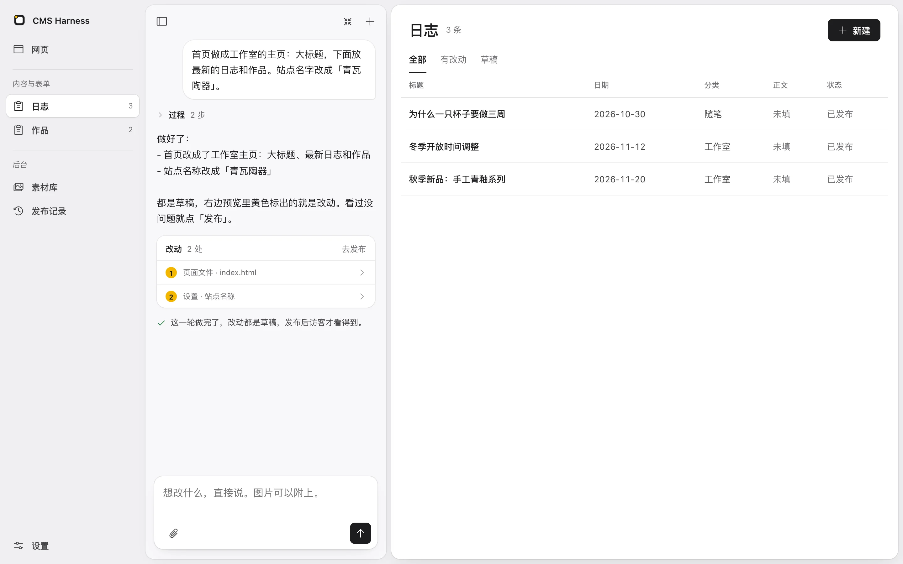

<p align="center">
  
</p>

<h3 align="center">整个应用让 AI 来建，但它一个字也发布不了。</h3>

<p align="center">
  页面、后端、数据、账号、AI 对话、接口，全在<b>一个不到 10 MB 的下载包</b>和<b>一个 SQLite 文件</b>里。<br>
  不用 Node，不用 Postgres，不用 Redis，不用打包。
</p>

<p align="center">
  <a href="https://github.com/Michaelzhao9/cms-harness/releases"></a>
  <a href="https://github.com/Michaelzhao9/cms-harness/actions/workflows/ci.yml"></a>
  <a href="https://github.com/Michaelzhao9/cms-harness/stargazers"></a>
  <a href="LICENSE"></a>
  
  
</p>

<p align="center">
  <a href="#-快速开始">快速开始</a> ·
  <a href="#-有什么">功能</a> ·
  <a href="#-接入-agent">接入 agent</a> ·
  <a href="#-参考">参考</a> ·
  <a href="README.md">English</a>
</p>

<p align="center">
  <br>
  <sub>演示（英文界面，后台可以切换成中文）</sub>
</p>

部署这一个程序，它就是整个环境，也是管理它的后台。打开后台直接说“首页做成工作室的主页”“加一个预约表单”，或者“给老师和学生各做一个界面，学生交作业，老师打分”，内置的对话助手就去建数据、写页面、写后端的函数，再建好管理它们的界面。它做的一切都是**草稿**：人看过改动、点了**发布**，线上才会变。

哪里不满意？不用再想一句提示词，**直接在页面上拖、拉、改字**。你自己的 agent（Claude Code、Codex 或任何 MCP 客户端）也能通过内置的 MCP 做同样的事。

## 哪里不一样

| 🛡️ AI 发布不了 | 📦 什么都不用装 | 🧩 不只是网站 | 🌐 页面是你自己的 |
| --- | --- | --- | --- |
| 内容、页面、后端的函数、设置、后台界面全是草稿。每一处改动新旧对照给你看，不要的取消勾选。每次发布都有记录，可以恢复。 | 一个可执行文件就提供网站、后台、对话、会员账号和接口。数据是一个 SQLite 文件，整站备份是一个 zip。 | 一个环境里可以有多个端：每种使用者一个界面，各有进门规则，数据共用。后端是沙箱里的函数，小程序和 App 用同一套接口。 | HTML、CSS、JavaScript，支持模板、JSX、TypeScript，React、Vue 用 import map 加载，不用打包。也可以整站导出成静态文件。 |

## 🚀 快速开始

```sh
curl -O https://raw.githubusercontent.com/Michaelzhao9/cms-harness/main/docker-compose.yml
docker compose up -d
docker compose exec cms-harness cms-harness admin 你的邮箱          # 打印管理员密码，只显示一次
```

打开 `http://localhost:4200/admin` 登录。网站本身在 `http://localhost:4200/`。

然后打开 **设置 → 对话用的模型**，选一家服务、填密钥、点「检测」。好了，开口说话就行。

<details>
<summary><b>不用 Docker：下载程序或从源码编译</b></summary>

<br>

在 [Releases](https://github.com/Michaelzhao9/cms-harness/releases) 下载 Linux（x86_64、arm64）、macOS（Apple 芯片）、Windows 的程序，或者从源码编译（需要 Rust 1.98 或更新版本）：

```sh
git clone https://github.com/Michaelzhao9/cms-harness.git
cd cms-harness
cargo build --release
./target/release/cms-harness admin 你的邮箱          # 新建后台管理员，打印密码，只显示一次
./target/release/cms-harness                        # 启动，监听 127.0.0.1:4200
```

打开 `http://127.0.0.1:4200/admin` 登录。
</details>

<details>
<summary><b>放到正式域名上</b></summary>

<br>

服务本身只提供 HTTP，所以要在前面放一个反向代理（Caddy、nginx）负责 HTTPS，并把 `HC_ORIGIN` 设成对外的网址，必须和浏览器地址栏完全一致（`https://example.com`）。在 `docker-compose.yml` 里就是 `HC_ORIGIN` 那一行。直接运行程序时，它只监听本机地址。国内服务器要先备案。

对话用的模型也可以不在设置里配，改用环境变量：`LLM_PROVIDER`（`anthropic` 或 `openai`）、`LLM_API_KEY`、`LLM_MODEL`、`LLM_BASE_URL`。不配模型时，后台和接口照常可用，只是没有对话。
</details>

## ✨ 有什么

> 标 🆕 的是 0.3 新增的。

### 让 AI 动手，而且放心

- 🤖 **AI 动手，人来发布。** 对话助手不能发布。记录、网页、上传文件里的文字，它只当数据，不当指令。
- 📝 **什么都是草稿。** 内容、集合、页面、后台界面、设置，发布前都是草稿。线上网站永远只显示已发布的版本，不管谁来访问。草稿和线上可以并排对比。
- 🗂️ **后台跟着网站走。** 网站加了表单、会员、订单，助手在同一轮里就建好管理它们的界面。后台导航按网站自己的栏目分组。网站上没用到的集合会标成「网站上还没用到」，旁边一个按钮就能让对话把它做到网站上。
- 🔍 **写完自己先查一遍。** 🆕 助手用 `check_page` 把草稿页面真的渲染一遍：有没有报错、死链、缺的文件、整张原图直接放上去的图片；函数用 `run_function` 先试运行，什么都不会真的写入。长任务它会列出任务清单，同一步原地打转就停下来。
- 🧠 **什么模型都能用。** Claude、OpenAI、Gemini、DeepSeek、通义千问、Kimi、智谱 GLM、豆包、硅基流动、Mistral、xAI、Groq、OpenRouter，本机的 Ollama、LM Studio，或任何兼容 OpenAI 的接口。填好密钥就能列出可用的型号。
- 🔌 **你的 agent 也能接。** 内置 MCP 服务和 REST 接口，45 个工具，密钥分权限（`read`、`write`、`structure`、`publish`）。
- 🌍 **对话联网搜索（默认关闭）。** `web_search` 和 `fetch_page` 走自己部署的 SearXNG、Brave 或 Tavily，任何模型都能用。网页内容只当资料，不当指令；内网和本机地址每一次跳转都会检查，读不了。
- 📚 **技能。** 从 GitHub 或 zip 安装技能文件夹（带 `SKILL.md`），对话遇到相关的事会自己去读。

### 不只是网站：一个环境，多个端 &nbsp;<sup>0.3 新增</sup>

- 🧩 **每种使用者一个端。** 网站本身是第一个端；学生和老师、顾客和店员要用不同的界面时，助手给每一种人建一个端（`/teacher/`、`/student/`），各有自己的页面和进门规则，数据是整个环境共用的。进门规则可以是“登录会员”，也可以是一句条件，比如 `member.kind == 'teacher'`。门由系统把，页面不用自己检查。后台左边列出所有端，「环境」页一眼看到每个端和它们共用的数据。
- ⚙️ **后端也是它写的。** 页面脚本和规则做不了的事（下单同时扣库存、算总分、要查几张表才能决定的权限），助手写成服务器端的函数：`_fn/order.js` 就是网址 `/_fn/order`。函数跑在沙箱里，没有网络、文件和定时器，时间和内存都有上限；一次运行是一个事务，出错就什么都不留。它和别的站点文件一样是草稿，发布后才生效，写完可以先试运行。
- 👥 **会员、属性和访问规则。** 访客可以注册登录，和后台管理员是两套账号。会员可以带你自己定的属性（`kind: teacher`、`class: 3`），系统不给它们任何含义。每个集合的读、新增、修改、删除各有规则：一个词（所有人、登录会员、只看自己的、不公开），或一句条件，比如 `record.owner == member.id or member.kind == 'teacher'`。读的规则同时过滤每个人看到的列表、总数和搜索结果。
- 📱 **小程序和 App 用同一个后端。** 内容接口按同一套规则读、提交、修改、删除；没有 cookie 的客户端用令牌登录；`_fn` 下的函数就是它们自己的接口。
- 🔔 **有事发到群里。** 在 **设置 → 通知** 贴上飞书或企业微信群机器人的 Webhook 地址（也可以填你自己的地址），有人提交了内容、发布了修改、有新会员注册时就发一条消息；函数里用 `notify("…")` 发自己的消息。发到哪里只有搭建者能定，对话和密钥都加不了去处。
- 🛡️ **自带防护，不用设置。** 环境里建出来的每个页面和接口天生在同一道门后面：限速、拦下漏洞探测、不给 AI 爬虫和脚本工具看页面（搜索引擎照常放行）、翻页太快的访客要先在浏览器里通过一次验证，全程不依赖外部服务。后台里没有它的页面，也没有开关：它一直开着，级别写在代码里（`src/shield.rs`），对话、密钥和后台账号都改不了。

### 直接在页面上动手改 &nbsp;<sup>0.2 新增</sup>

- ✏️ **预览里点哪改哪。** 一条小工具栏可以改字号、粗细、颜色、对齐、圆角、阴影、内边距。双击直接改字。
- 🖱️ **拖动、缩放、复制、删除。** 元素会自动吸附到旁边元素的边和中线。方向键微调，Cmd/Ctrl+Z 撤销。
- 🖊️ **画笔：点哪加哪。** 文字、矩形、圆、线、按钮，还有上传的图片。
- 📱 **按宽度分别调。** 只改电脑、平板或手机上的样子，也能把某个宽度恢复成电脑版。
- ⚠️ **只提醒，不乱猜。** 手动调过的元素跑出屏幕、盖住别的内容、字小于 12 px，工具栏上会计数，点一下跳到每一处。
- 🤝 **AI 知道你改过什么。** 它看得到你的手动调整，重写页面时会带着走；会丢掉某处调整的重写，要你同意才执行。

手动调整和别的改动一样，也是草稿。

### 真正的网站

- 🔗 **每条内容自动有自己的页面。** 写一个详情模板，集合里每条记录就有自己的页面和干净的网址（`/news/鼓手大赛`，中文标题就是中文网址）。改了网址名或分类，旧网址永久跳转。正文里的链接认的是那条记录而不是网址，所以永远不会断；发布会留下死链时直接拦下。
- 🌏 **任意多种语言。** 一条内容、多种语言：文字分语言翻译，图片、日期、价格共用。每种语言有自己的网址（`/en/…` 或单独的域名）、回退顺序、hreflang，日期和金额按语言格式显示。过期的译文会标出来，对话还能把所有语言自动同步成草稿。
- ⚡ **动态网站，静态网站的速度。** 线上页面会缓存，一次发布只重算它影响到的页面。`cms-harness export` 能把整个网站导出成静态文件，放到任何 CDN 上。
- 🧩 **技术栈随你，不用打包。** HTML 加 `{{ }}` 模板，还能写 CSS、JavaScript、JSX、TypeScript（访问时自动转换）。React、Vue、Three.js 通过 import map 加载；用 Vite 打包好的网站也能整个上传。
- 🖼️ **照片不用自己处理。** 🆕 上传的照片自动扶正、去掉拍摄地点和时间这些信息、最长边缩到 2560 以内并压缩（一张 7 MB 的照片存下来约 0.5 MB）；存成 PNG 的照片会变成 JPEG，透明图和小图原样保留。页面里 `{{ img(item.cover, alt=item.title) }}` 写出整个图片标签：各种宽度的缩小版、宽高、延迟加载；只要网址时用 `{{ item.cover|thumb(640) }}`。对话里附的图，模型看到的是缩小的一份。
- 🔎 **全文搜索。** 页面里用 `search("关键词")`，接口 `GET /api/v1/search`，还有 `search` 工具。中文不用词库也能搜，访客只会搜到自己能看的内容。

### 管理和运行

- 🗂️ **直接管任何数据。** 🆕 每个集合的列表都能搜索（记录里任何地方的文字，草稿也搜得到）、导出成 CSV、把 CSV 里的行导入成草稿。导入前每一行都先检查，有一行不对就一行都不进；导出的表格里，会被表格软件当成公式执行的内容已经处理过。
- ⏰ **定时发布。** 在「发布前看一遍」里选一个时间，到时间按普通发布的检查和记录上线。
- 💾 **备份和恢复。** 整站（数据库和上传的文件）打成一个 zip，在 **设置 → 备份** 下载，或运行 `cms-harness backup`。恢复前会先检查备份，并把现在的整站另存一份。
- 🗺️ **SEO 基础，自动做好。** `sitemap.xml` 和 `robots.txt` 跟着每次发布更新，每种语言都有。
- 🈶 **中文和英文。** 后台在设置里切换，对话按管理员的语言回答。

<table>
  <tr>
    <td width="50%"></td>
    <td width="50%"></td>
  </tr>
  <tr>
    <td align="center"><sub>左边对话，右边草稿，改动都标出来。</sub></td>
    <td align="center"><sub>发布前看一遍：每一处改动，新旧对照。</sub></td>
  </tr>
  <tr>
    <td width="50%"></td>
    <td width="50%"></td>
  </tr>
  <tr>
    <td align="center"><sub>助手建好的内容表格，跟着网站一起变。</sub></td>
    <td align="center"><sub>刚部署好：只有一个页面，等你开口。</sub></td>
  </tr>
</table>

## 🔌 接入 agent

用 `cms-harness key <名字> [write] [structure] [publish]` 生成密钥，然后在支持 HTTP 的 MCP 客户端里加上：

```json
{
  "mcpServers": {
    "cms-harness": {
      "type": "http",
      "url": "http://127.0.0.1:4200/mcp",
      "headers": { "Authorization": "Bearer hc_..." }
    }
  }
}
```

密钥不给 `publish` 权限，你的 agent 干一整天，线上网站也纹丝不动。

也可以直接用 REST：`GET /api/v1/tools` 列出这把密钥能用的工具和参数，`POST /api/v1/tools/<工具名>` 调用。

## 🔧 底层

- 大约 19,000 行 Rust：[axum](https://github.com/tokio-rs/axum)、SQLite（内置，带全文搜索）、模板用 [minijinja](https://github.com/mitsuhiko/minijinja)，JSX 和 TypeScript 用 [oxc](https://oxc.rs) 转换，服务器端函数跑在 [QuickJS](https://bellard.org/quickjs/) 里（[rquickjs](https://github.com/DelSkayn/rquickjs)）。
- 450 多个测试，每次推送到 main 都连同 clippy 一起跑。
- 后台是服务端渲染的 HTML 加原生 JavaScript，配严格的 Content-Security-Policy，没有前端打包。
- 密码用 Argon2id 哈希。细节见 [SECURITY.md](SECURITY.md)。

## 📖 参考

<details>
<summary><b>命令行</b></summary>

| 命令 | 作用 |
| --- | --- |
| `cms-harness` | 启动服务 |
| `cms-harness admin <邮箱> [builder\|editor]` | 新建管理员，或重置他的密码 |
| `cms-harness key <名字> [write] [structure] [publish]` | 生成一把接口密钥（只显示一次） |
| `cms-harness admin-origin <网址\|off>` | 把后台放到自己的网址上；`off` 切回和网站同一个网址 |
| `cms-harness backup [文件.zip]` | 把整站（数据库和上传的文件）备份成一个 zip |
| `cms-harness restore <文件.zip>` | 用备份替换整站（先停掉正在运行的服务） |
| `cms-harness export <目录>` | 把线上网站导出成静态文件（`HC_ORIGIN` 设成它要放的网址） |

搭建者（builder）管结构、密钥、管理员、模型、技能和通知发到哪里；编辑（editor）写内容、发布内容。
</details>

<details>
<summary><b>网站页面</b></summary>

刚部署好的网站只有一个内置页面：显示站点名和进后台的链接。其他页面都是助手（或你的 agent）写的**网站文件**：

- HTML 模板：`collection("news", limit=10, sort="-date")`、算页码用的 `count("news", filter={...})`（`collection()` 一次最多返回 100 条）、`record("news", 3)`、`search(request.query.q, limit=20)`（每条结果带 `_collection` 和 `_snippet`）、写出整个图片标签的 `img(item.cover, alt=item.title)`、当前登录的会员 `member`（连同它的属性）、站点名 `site.name`。
- CSS、JavaScript，以及 JSX / TypeScript / TSX（访问时自动转换）。
- 第三方库通过 import map 从 `https://esm.sh` 加载（`set_site_settings`），不需要打包；别处打包好的网站可以整个上传（`upload_site_bundle`）。

线上网站永远只显示已发布的版本，不管访客带什么 cookie 或请求头。草稿只在后台的预览里看得到。

**记录页面。** 访客能看的集合，只要网站里有详情模板，每条记录就自动有页面：模板叫 `集合名/_item.html`，全站通用的叫 `_item.html`，模板里用 `item` 取这条记录。网址来自集合的 `url` 规则，默认 `/集合名/{slug}`；也可以用 `{id}`、某个字段（`{year}`）或关联字段的网址名（`/products/{category.slug}/{slug}`）。记录新建时从标题生成网址名，之后改标题网址不变；改网址名是草稿，上线后旧网址一直跳转到新的。链接到记录用 `item.url`（或 `/_r/编号`）：粘贴进正文的本站链接会自动存成这种形式，显示时总是记录现在的网址。

**多语言。** 在 **设置 → 网站语言** 设网站用哪些语言（或用 `set_site_settings` 的 `languages`），第一种是默认语言。其他语言的网址在 `/语言代码/` 下或用单独的域名，也可以设回退语言。文字和富文本字段会翻译（`translate: false` 的字段各语言共用）；集合设 `untranslated: "hide"` 时，没翻译的记录不出现在其他语言里。翻译用 `set_translation` 或在记录编辑页里写，作为草稿存在记录里，`translation_status` 列出缺翻译和过期的内容。模板里有 `lang`、`dir`、`languages`（这一页的所有语言版本，做语言切换用）和 `suggested_lang`；`{{ "…"|t }}` 读站点文字表；`|date`、`|number`、`|money("EUR")` 按语言格式化。模板里写成 `/about` 的链接，在英文页面上会通向 `/en/about`。hreflang 和多语言 sitemap 自动加好。

**图片。** 上传的 JPEG、PNG、WebP 存下来之前会处理一遍：按 EXIF 扶正并去掉 EXIF（拍摄地点、时间、设备），最长边超过 2560 就缩小，JPEG 重新压缩（能小五分之一以上，或者本来就要重做时才换）；不透明的大 PNG 转成 JPEG 不到原来四成就转。透明的图、小的 PNG、GIF 和 PDF 原样保留。`/uploads/<文件名>?w=640` 给出一份缩小的图，宽度取五档之一（384、640、828、1200、1920），只生成一次，之后一直用；PNG 还是 PNG，JPEG 和 WebP 变成 JPEG，不会放大。模板里 `{{ img(item.cover, alt=item.title, sizes="50vw", class="cover") }}` 写出整个 ``：`srcset` 里是比原图窄的各档，带原图的宽高和 `loading="lazy"`；一屏里最先看到的那张加 `eager=true`。只要网址的地方用 `|thumb(640)`。

**缓存和导出。** 没登录的访客看到的线上页面会缓存，直到它读过的内容再次发布（响应头 `x-cms-cache` 显示 hit 或 miss）。`cms-harness export <目录>` 导出所有公开页面（含记录页面）、网站文件、上传文件、`sitemap.xml`、`robots.txt` 和 `404.html`；把 `HC_ORIGIN` 设成这些文件要放的网址。表单和登录还是要靠服务器，命令会列出用到它们的页面。

`/sitemap.xml` 列出已发布的页面（不含被别的文件 extends、include 的布局和片段，也不含 `_` 开头的文件），带上每页最近一次上线的日期；`/robots.txt` 指向它。两者都跟着每次发布更新。网站里有同名文件时用网站自己的。
</details>

<details>
<summary><b>手动调整页面</b></summary>

在草稿预览里选中一个元素：点一下不会触发任何动作的地方、长按，或者右键。元素上方的工具栏可以改字号、粗细、斜体、下划线、颜色、对齐、样式预设、圆角、阴影、内边距，对所有宽度生效或只对当前宽度生效；还能复制、删除、上移或下移一层、在当前宽度隐藏。双击可以改模板里写的文字。

- **移动和缩放。** 拖动元素来移动，拉手柄来缩放，都会吸附到旁边的元素，按住 Alt 关掉吸附。方向键每次移 1 px，Shift+方向键移 10 px。Cmd/Ctrl+Z 撤销，Shift+Cmd/Ctrl+Z 重做。Delete 删除元素，Cmd/Ctrl+D 复制一份。
- **画笔**（预览右下角）在你下一次点击的位置加上文字、矩形、圆、线、按钮或一张上传的图片。选中的图片可以换成另一张。
- **共用的元素。** 元素所在的模板被别的页面共用时，会标出「共用 · N 页」，它的调整可以限定在当前页面。
- **宽度。** 调整存在你正在看的那个宽度上。电脑版预览不会窄于 1024 px，面板更窄时按比例缩小显示。
- **和 AI 一起。** `get_site_file` 会返回 `hand_edits`，重写文件时这些调整跟着走；会丢掉某处调整的重写会被拒绝，除非带上 `replace_hand_edits: true`。

属性和取值都来自固定的列表，输入的文字会转义、不可能变成模板代码，只有上传的文件能放进模板。
</details>

<details>
<summary><b>服务器端函数</b></summary>

`_fn` 文件夹下的站点文件（`.js` 或 `.ts`）是服务器端的函数，网址是去掉扩展名的路径：`_fn/order.js` 是 `/_fn/order`，`teacher/_fn/grade.js` 是 `/teacher/_fn/grade`。放在某个端的文件夹里就归那个端，只让会员进的端，它的函数也只让会员调。源码永远不会被当成文件发出去。

```js
export default function (req) {
  // req.method, req.path, req.query, req.body, req.member（没登录是 null）
  const mine = db.query("orders", { owner: req.member.id, limit: 100 });
  if (mine.total >= 3) return reply(409, { error: "每人最多 3 单" });
  const id = db.create("orders", { item: req.body.item });
  return { id };
}
```

- 数据：`db.query(集合, {filter, sort, limit, offset, search, owner})`、`db.get(集合, 编号)`、`db.create(集合, 数据)`、`db.update(集合, 编号, 数据)`、`db.delete(集合, 编号)`。读写的是线上的数据，写入立即生效，和别的写入一样要通过字段校验，历史里记在 `fn:<文件>` 名下。函数不受集合访问规则的限制：谁能做什么，由函数自己判断。
- 汇总：`db.aggregate(集合, {filter, group_by, sum, avg, min, max})`。
- 通知：`notify("库存不足：" + item)` 发到 **设置 → 通知** 里接好的群，一次运行最多 5 条；运行不算数（出错、试运行）就不发。
- 回答：返回值就是 JSON；要别的状态码用 `reply(状态码, 内容)`。
- 一次运行是一个事务：抛出异常、被中止，或者回答 400 及以上，它写的都不保留。
- 限制：最多运行 500 毫秒、32 MB 内存、200 次数据读写，请求内容最大 64 KB。没有网络、文件、进程和定时器。
- 出错时访客只看到“这个功能出错了”，原因在 `function_log` 里。
- `run_function` 试运行草稿里的函数，什么都不会真的写入。后台预览里页面调用函数（GET）也是试运行。
- 导出成静态网站时，函数不会被导出，也不能工作。
</details>

<details>
<summary><b>会员和访问规则</b></summary>

`set_member_login` 打开访客账号后，网站就有 `/account/signup`、`/account/login`、`/account/logout` 页面和 `/api/v1/members/*` 接口，后台左边出现「用户管理」。会员不能登录后台。

每个集合可以设定：
- 谁能看（`read`）：`public` 所有人、`members` 登录会员、`owner` 每个会员只看自己的、`private` 只有后台和接口密钥（默认），或一句条件，比如 `record.open == true or record.owner == member.id`。条件同时是列表的过滤器：每个人的列表、总数、搜索里只有自己能看的那些。
- 谁能从网站提交（`create`）：`none`（默认）、`members`、`public`，或一句条件，比如 `member.kind == 'student' and data.class == member.class`。提交的内容直接上线并记下提交人，后台显示“N 条新”。网站表单提交到 `POST /<集合>/new`，接口用 `POST /api/v1/content/<集合>`。
- 谁能从网站修改（`update`）和删除（`delete`）已有的记录：`none`（默认）、`owner`（提交它的会员）、`members`，或一句条件，比如 `record.owner == member.id and data.status == record.status`。条件里能用 `record.字段`、`record.id`、`record.owner`、`member`（已登录）、`member.id`、`member.email`、`member.name`、`data.字段`（改完之后的样子），以及 `== != < <= > >=`、`and or not` 和括号。修改和删除直接生效，历史里留着原来的内容。接口用 `PATCH` 和 `DELETE /api/v1/content/<集合>/<编号>`。

会员可以带属性（`kind: teacher`、`class: 3`），由搭建者在「用户管理」里或用 `set_member_data` 设置，会员自己改不了。系统不给属性任何含义：规则里写 `member.kind`，端的进入条件写 `member.kind == 'teacher'`，页面和函数里也读得到。

小程序、手机和桌面应用没有 cookie：登录或注册时带上 `"session": "token"`，回答里就有一个令牌，之后的请求放在 `Authorization: Bearer <令牌>` 里。

集合还可以放进一个 `group`（网站的栏目）并设 `position`：后台导航按这个顺序排列，每个分组可以折叠。
</details>

<details>
<summary><b>通知（Webhook）</b></summary>

**设置 → 通知**（只有搭建者看得到）里贴一个 Webhook 地址，勾上什么时候发：有人提交了内容、发布了修改、有新会员注册、函数里的 `notify()`。它是哪一种，从地址上认：

- 飞书（`open.feishu.cn`、`open.larksuite.com`）：发一条文字消息；机器人开了“签名校验”就把密钥也填上。
- 企业微信（`qyapi.weixin.qq.com`）：发一条文字消息。
- 其他地址：`POST` 一个 JSON `{"event", "text", "data", "site", "at"}`，请求头有 `X-Harness-Event` 和 `X-Harness-Timestamp`；填了签名密钥，`X-Harness-Signature` 是 `sha256=` 加上 `HMAC-SHA256(密钥, "<时间戳>.<正文>")` 的十六进制。

消息先和它说的那件事一起写进数据库，再每 3 秒发一轮，每个去处一轮一条；发不出去隔 1 分钟、5 分钟各再试一次。地址存下来之后不再显示，只显示主机名。「发送测试」马上发一条并告诉你结果。
</details>

<details>
<summary><b>自己的前端读取内容</b></summary>

`GET /api/v1/content/<集合>` 返回已发布的记录，`GET /api/v1/content/<集合>/<编号>` 返回一条，按集合的“谁能看”规则。

| 参数 | 作用 |
| --- | --- |
| `字段=值` | 等于 |
| `字段__ne` `__gt` `__gte` `__lt` `__lte` `__contains` | 不等于、大于、大于等于、小于、小于等于、包含 |
| `sort=字段`、`sort=-字段` | 排序，`-` 表示倒序 |
| `limit`、`offset` | 分页，`limit` 为 1 到 100 |
| `expand=字段` | 把关联字段展开成目标记录 |

只有声明了 `index` 或 `unique` 的字段能用来筛选和排序。
</details>

<details>
<summary><b>上传文件</b></summary>

`POST /api/v1/media`，multipart 表单，文件放在名为 `file` 的字段里，需要带 `write` 权限的密钥，最大 20 MB；也可以用工具 `upload_media` 以 base64 传（最大 5 MB）。支持 JPEG、PNG、GIF、WebP、PDF，按内容判断格式。文件按内容命名，存在 `/uploads/<哈希>.<扩展名>`，长期缓存；图片加上 `?w=640` 就是缩小的版本。图片存下来之前会处理（见“网站页面”里的图片一段），所以回答里除了 `path`，还有存下来的 `width`、`height` 和 `bytes`。上传的文件是公开的，不要上传需要保密的文件。
</details>

<details>
<summary><b>工具</b></summary>

| 工具 | 权限 | 作用 |
| --- | --- | --- |
| `list_collections` `get_collection` | read | 列出集合、查看定义 |
| `create_collection` `update_collection` `delete_collection` | structure | 新建、修改（字段、访问规则、网址规则 `url`、导航分组 `group` 和 `position`）、删除集合（记录保留） |
| `get_record` `query_records` `aggregate_records` `search` | read | 读记录、汇总（分组、求和、平均、最大最小）、全文搜索 |
| `create_record` `update_record` `delete_record` | write | 写记录（含网址名 `slug`） |
| `list_pending` `list_versions` | read | 待发布的改动、发布历史 |
| `publish` | publish | 发布 |
| `schedule_publish` `cancel_schedule` / `list_schedules` | publish / read | 定时发布 |
| `restore_version` `discard_draft` | write | 把历史版本放回草稿、丢弃草稿 |
| `list_views` / `set_view` `delete_view` | read / structure | 后台界面 |
| `get_site_notes` / `set_site_notes` | read / structure | 给助手看的站点说明 |
| `check_page` | read | 检查草稿里的一个页面：渲染报错、死链、缺的文件、该补的东西 |
| `run_function` / `function_log` | read | 试运行草稿里的服务器端函数（不写入）；线上函数出错或写了日志的运行 |
| `list_site_files` `get_site_file` | read | 读网站文件（连同上面的手动调整） |
| `write_site_file` `delete_site_file` `upload_site_bundle` | structure | 写网站文件、上传打包好的网站 |
| `get_site_settings` / `set_site_settings` | read / structure | 站点名称、语言、模板文字翻译、import map、脚本来源 |
| `translation_status` / `set_translation` | read / write | 缺翻译和过期的内容；写翻译 |
| `set_member_login` | structure | 打开或关闭会员账号 |
| `list_ends` / `set_end` `delete_end` | read / structure | 列出端；新建、修改（标题、谁能进）、删除一个端（连同它的文件） |
| `list_members` / `set_member_status` `set_member_data` | read / write | 列出会员；停用或恢复、设置属性 |
| `upload_media` | write | 上传图片或 PDF，返回路径和存下来的宽高 |

所有密钥都能读。改结构、界面、网站文件和站点说明需要 `structure`。
</details>

<details>
<summary><b>环境变量</b></summary>

| 变量 | 默认值 | 作用 |
| --- | --- | --- |
| `HC_HOST` | `127.0.0.1` | 监听地址（Docker 镜像里是 `0.0.0.0`） |
| `HC_PORT` | `4200` | 端口 |
| `HC_DATA` | `data` | 数据目录，上传的文件也在这里（Docker 镜像里是 `/data`） |
| `HC_DB` | `<HC_DATA>/harness.db` | 数据库文件 |
| `HC_ORIGIN` | `http://127.0.0.1:<端口>` | 对外网址，必须和浏览器地址栏完全一致 |
| `HC_SITE_NAME` | `CMS Harness` | 在设置里改名之前用的站点名 |
| `HC_ADMIN_PASSWORD` | 随机 | `cms-harness admin` 用的密码 |
| `HC_TRUST_PROXY` | 不设 | 反向代理在别的机器上时设为 `1` |
| `HC_ADMIN_ORIGIN` | 不设 | 后台单独的网址（`https://admin.example.com`），或 `off` |
| `HC_FETCH_ALLOW_PRIVATE` | 不设 | 设为 `1` 时，对话读网页和通知可以连内网地址（内网部署用） |
| `LLM_PROVIDER` `LLM_API_KEY` `LLM_MODEL` `LLM_BASE_URL` | 不设 | 对话用的模型，优先于设置 |

用 nginx 时加上 `proxy_set_header X-Forwarded-For $proxy_add_x_forwarded_for;` 和 `proxy_set_header Host $host;`，频率限制才能区分访客。Caddy 默认就会加。
</details>

## 🔒 安全

网站要运行不是你自己写的脚本时，先读 [SECURITY.md](SECURITY.md)：它说明什么时候该给后台单独的网址（**设置 → 后台的网址**）。防护做了什么和没做什么、服务器端函数的沙箱、通知和上传图片的处理，也都写在那里。

## 📄 许可证

[AGPL-3.0](LICENSE)。用 CMS Harness 搭的网站、通过接口读取内容的前端、数据库里的内容，都不是它的衍生作品。只有修改了 CMS Harness 本身并对外提供服务时，才需要公开你的修改。贡献代码需要签署贡献者授权协议，见 [CONTRIBUTING.md](CONTRIBUTING.md)。

---

<p align="center">
  如果 CMS Harness 正是你想要的，点个 ⭐ 能让更多人看到它。
</p>
