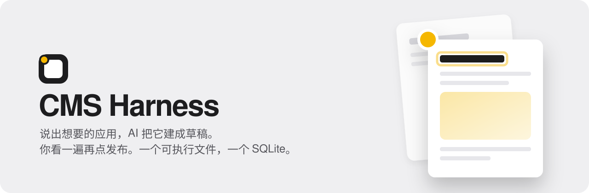
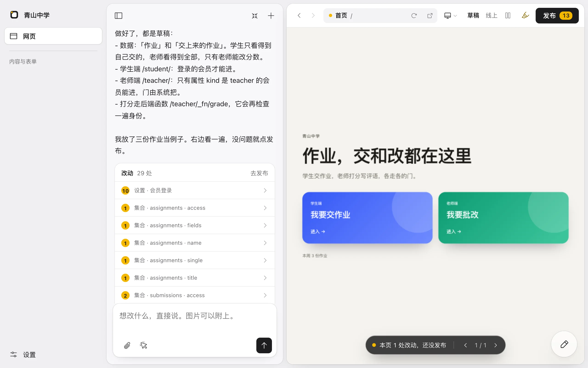
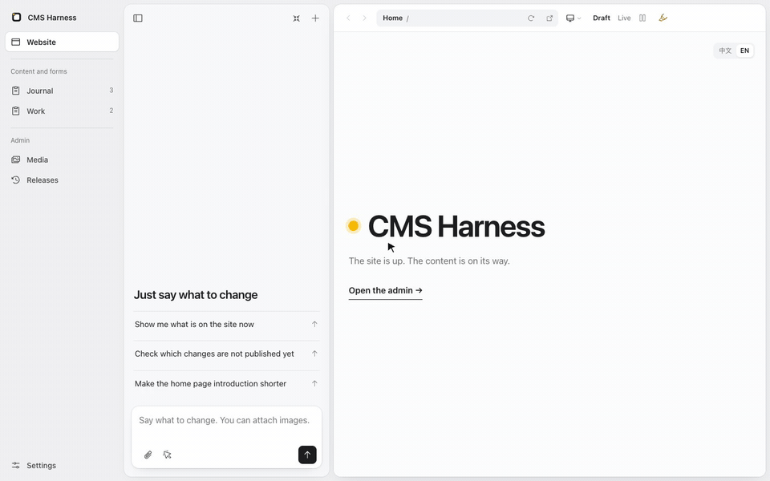
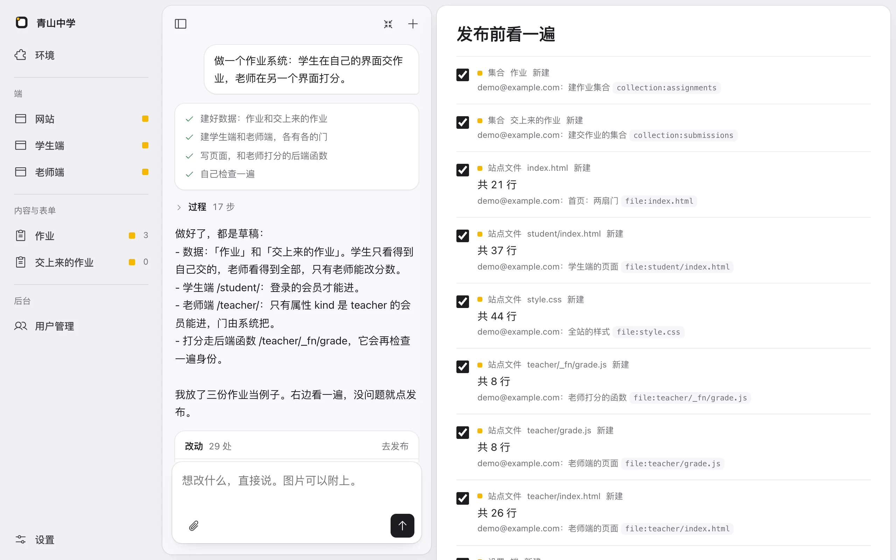
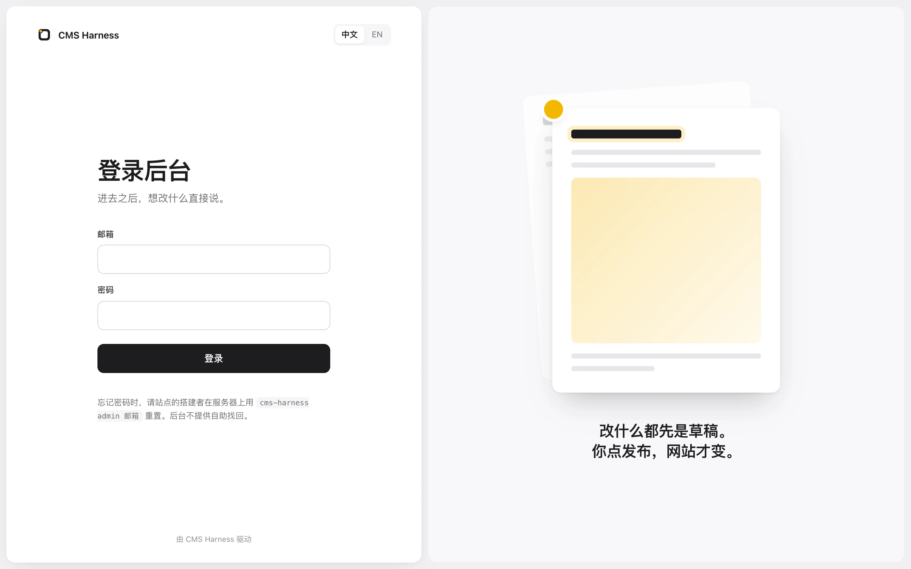
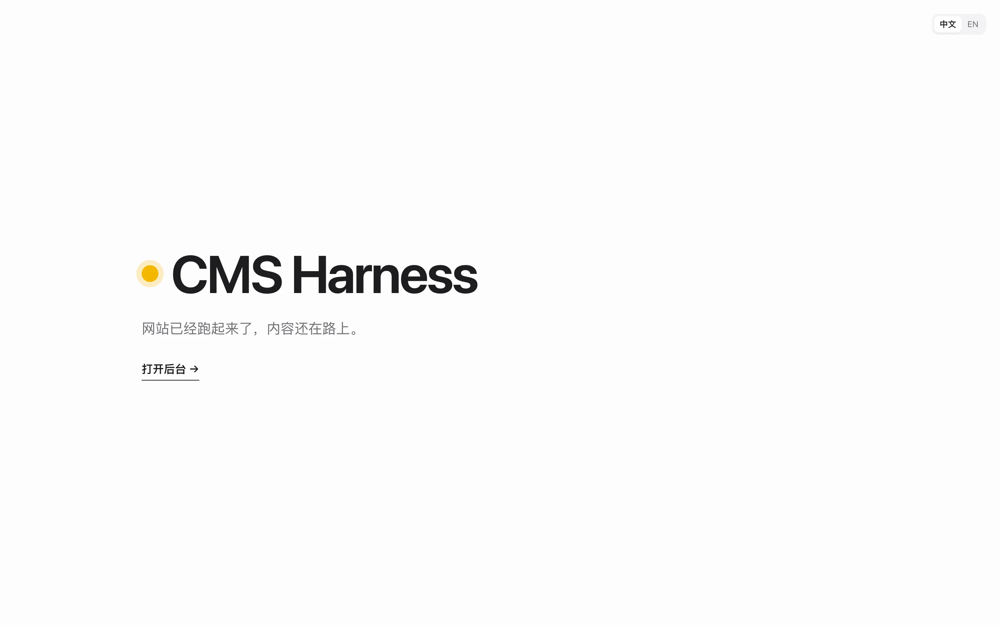

<p align="center">
  
</p>

<p align="center">
  <a href="LICENSE"></a>
  
  
  
  
</p>

<p align="center"><a href="README.md">English</a> · <b>中文</b></p>

**CMS Harness 是一个让 AI 来管的网站后台，网站和后台都在一个 Rust 可执行文件里。** 打开后台直接说“首页做成工作室的主页”“加一个预约表单”“网站加会员注册”，内置的对话助手就去改内容、改页面、建后台界面。所有改动都是草稿，人点了**发布**才上线。你自己的 agent（Claude Code、Codex 或任何 MCP 客户端）也能通过内置的 MCP 做同样的事。

不依赖任何外部服务。一个可执行文件加一个 SQLite 文件，就提供网站、后台、对话、会员账号和接口。

<p align="center">
  
</p>

## 怎么用

| 1. 说 | 2. 看草稿 | 3. 发布 |
| --- | --- | --- |
| 在对话里说想要什么，也可以在预览里点选元素再问。 | 助手把内容、页面、后台界面都写成**草稿**。预览里标出每一处改动，线上网站不动。 | 看一遍改动清单，不要的取消勾选，然后发布。每次发布都有记录，可以恢复。 |

<p align="center"><br><sub>演示（英文界面）</sub></p>

## 有什么

- **AI 动手，人来发布。** 对话助手不能发布。记录、网页、上传文件里的文字，它只当数据，不当指令。
- **什么都是草稿。** 内容、集合、页面、后台界面、设置，发布前都是草稿。线上网站永远只显示已发布的版本，不管谁来访问。
- **每条内容自动有自己的页面。** 写一个详情模板，集合里每条记录就有自己的页面和干净的网址（`/news/鼓手大赛`，中文标题就是中文网址）。网址跟着数据走：改了网址名或分类，旧网址永久跳转；正文里的链接认的是那条记录而不是网址，所以永远不会断；发布会留下死链时直接拦下。
- **动态网站，静态网站的速度。** 线上页面会缓存，一次发布只重算它影响到的页面。`cms-harness export` 能把整个网站导出成静态文件，放到任何 CDN 上。
- **真正的网站。** 页面是 HTML 加 `{{ }}` 模板，还能写 CSS、JavaScript、JSX、TypeScript（访问时自动转换）。React、Vue、Three.js 通过 import map 加载，不需要打包；用 Vite 打包好的网站也能整个上传。
- **后台跟着网站走。** 网站加了表单、会员、订单，助手在同一轮里就建好管理它们的界面；功能删掉，界面也一起删掉。打开会员登录，左边自动出现「用户管理」。
- **会员和访问规则。** 访客可以注册登录，和后台管理员是两套账号。每个集合可以设定谁能看（所有人、登录会员、只看自己的、不公开）、谁能从网站提交。
- **什么模型都能用。** Claude、OpenAI、Gemini、DeepSeek、通义千问、Kimi、智谱 GLM、豆包、硅基流动、Mistral、xAI、Groq、OpenRouter，本机的 Ollama、LM Studio，或任何兼容 OpenAI 的接口。填好密钥就能列出可用的型号。
- **对话联网搜索（默认关闭）。** 搭建者可以打开 `web_search` 和 `fetch_page`，走自己部署的 SearXNG、Brave 或 Tavily。任何模型都能用，DeepSeek 也行。网页内容只当资料，不当指令；内网和本机地址每一次跳转都会检查，读不了。
- **技能。** 从 GitHub 或 zip 安装技能文件夹（带 `SKILL.md`），对话遇到相关的事会自己去读。
- **你的 agent 也能接。** 内置 MCP 服务和 REST 接口，密钥分权限（`read`、`write`、`structure`、`publish`）。
- **全文搜索。** 页面里用 `search("关键词")`，接口 `GET /api/v1/search`，还有 `search` 工具。中文不用词库也能搜，访客只会搜到自己能看的内容。
- **定时发布。** 在「发布前看一遍」里选一个时间，或调用 `schedule_publish`。到时间按普通发布的检查和记录上线，发布人是设定它的人。
- **备份和恢复。** 整站（数据库和上传的文件）打成一个 zip，在 **设置 → 备份** 下载，或运行 `cms-harness backup`。恢复前会先检查备份，并把现在的整站另存一份。
- **中文和英文。** 后台在设置里切换，对话按管理员的语言回答。内置页面按访客的浏览器显示，也有 中文 / EN 切换。

<table>
  <tr>
    <td width="50%"></td>
    <td width="50%"></td>
  </tr>
  <tr>
    <td align="center"><sub>发布前看一遍：每一处改动，新旧对照。</sub></td>
    <td align="center"><sub>助手建好的内容表格，跟着网站一起变。</sub></td>
  </tr>
  <tr>
    <td width="50%"></td>
    <td width="50%"></td>
  </tr>
  <tr>
    <td align="center"><sub>后台登录页。</sub></td>
    <td align="center"><sub>刚部署好：只有一个页面，等你开口。</sub></td>
  </tr>
</table>

## 快速开始

用 Docker：

```sh
curl -O https://raw.githubusercontent.com/Michaelzhao9/cms-harness/main/docker-compose.yml
docker compose up -d
docker compose exec cms-harness cms-harness admin 你的邮箱          # 打印管理员密码，只显示一次
```

也可以在 [Releases](https://github.com/Michaelzhao9/cms-harness/releases) 下载 Linux、macOS、Windows 的程序，或者从源码编译（需要 Rust 1.85 或更新版本）：

```sh
git clone https://github.com/Michaelzhao9/cms-harness.git
cd cms-harness
cargo build --release
./target/release/cms-harness admin 你的邮箱          # 新建后台管理员，打印密码，只显示一次
./target/release/cms-harness                        # 启动，监听 127.0.0.1:4200
```

打开 `http://127.0.0.1:4200/admin` 登录。网站本身在 `http://127.0.0.1:4200/`。

要用对话，打开 **设置 → 对话用的模型**，选一家服务、填密钥、点「检测」。也可以用环境变量 `LLM_PROVIDER`（`anthropic` 或 `openai`）、`LLM_API_KEY`、`LLM_MODEL`、`LLM_BASE_URL` 配置。不配模型时，后台和接口照常可用，只是没有对话。

对外提供服务时，在前面放一个反向代理（nginx、Caddy）负责 HTTPS。服务只监听本机地址。把 `HC_ORIGIN` 设成对外的网址。

命令行也能备份和恢复（恢复前先停掉服务）：

```sh
./target/release/cms-harness backup site.zip
./target/release/cms-harness restore site.zip
HC_ORIGIN=https://example.com ./target/release/cms-harness export ./public   # 导出成静态网站
```

## 接入 agent

用 `cms-harness key <名字> [write] [structure] [publish]` 生成密钥，然后在支持 HTTP 的 MCP 客户端里加上：

```json
{
  "mcpServers": {
    "cms-harness": {
      "type": "http",
      "url": "http://127.0.0.1:4200/mcp",
      "headers": { "Authorization": "Bearer hc_..." }
    }
  }
}
```

也可以直接用 REST：`GET /api/v1/tools` 列出这把密钥能用的工具和参数，`POST /api/v1/tools/<工具名>` 调用。

## 参考

<details>
<summary><b>网站页面</b></summary>

刚部署好的网站只有一个内置页面：显示站点名和进后台的链接。其他页面都是助手（或你的 agent）写的**网站文件**：

- HTML 模板：`collection("news", limit=10, sort="-date")`、`record("news", 3)`、`search(request.query.q, limit=20)`（每条结果带 `_collection` 和 `_snippet`）、当前登录的会员 `member`、站点名 `site.name`。
- CSS、JavaScript，以及 JSX / TypeScript / TSX（访问时自动转换）。
- 第三方库通过 import map 从 `https://esm.sh` 加载（`set_site_settings`），不需要打包；别处打包好的网站可以整个上传（`upload_site_bundle`）。

线上网站永远只显示已发布的版本，不管访客带什么 cookie 或请求头。草稿只在后台的预览里看得到。

**记录页面。** 访客能看的集合，只要网站里有详情模板，每条记录就自动有页面：模板叫 `集合名/_item.html`，全站通用的叫 `_item.html`，模板里用 `item` 取这条记录。网址来自集合的 `url` 规则，默认 `/集合名/{slug}`；也可以用 `{id}`、某个字段（`{year}`）或关联字段的网址名（`/products/{category.slug}/{slug}`）。记录新建时从标题生成网址名，之后改标题网址不变；改网址名是草稿，上线后旧网址一直跳转到新的。链接到记录用 `item.url`（或 `/_r/编号`）：粘贴进正文的本站链接会自动存成这种形式，显示时总是记录现在的网址。

**缓存和导出。** 没登录的访客看到的线上页面会缓存，直到它读过的内容再次发布（响应头 `x-cms-cache` 显示 hit 或 miss）。`cms-harness export <目录>` 导出所有公开页面（含记录页面）、网站文件、上传文件、`sitemap.xml`、`robots.txt` 和 `404.html`；把 `HC_ORIGIN` 设成这些文件要放的网址。表单和登录还是要靠服务器，命令会列出用到它们的页面。

`/sitemap.xml` 列出已发布的页面（不含被别的文件 extends、include 的布局和片段，也不含 `_` 开头的文件），带上每页最近一次上线的日期；`/robots.txt` 指向它。两者都跟着每次发布更新。网站里有同名文件时用网站自己的。
</details>

<details>
<summary><b>会员和访问规则</b></summary>

`set_member_login` 打开访客账号后，网站就有 `/account/signup`、`/account/login`、`/account/logout` 页面和 `/api/v1/members/*` 接口，后台左边出现「用户管理」。会员不能登录后台。

每个集合可以设定：
- 谁能看（`read`）：`public` 所有人、`members` 登录会员、`owner` 每个会员只看自己的、`private` 只有后台和接口密钥（默认）；
- 谁能从网站提交（`create`）：`none`（默认）、`members`、`public`。提交的内容直接上线并记下提交人，后台显示“N 条新”。网站表单提交到 `POST /<集合>/new`，接口用 `POST /api/v1/content/<集合>`。
</details>

<details>
<summary><b>自己的前端读取内容</b></summary>

`GET /api/v1/content/<集合>` 返回已发布的记录，`GET /api/v1/content/<集合>/<编号>` 返回一条，按集合的“谁能看”规则。

| 参数 | 作用 |
| --- | --- |
| `字段=值` | 等于 |
| `字段__ne` `__gt` `__gte` `__lt` `__lte` `__contains` | 不等于、大于、大于等于、小于、小于等于、包含 |
| `sort=字段`、`sort=-字段` | 排序，`-` 表示倒序 |
| `limit`、`offset` | 分页，`limit` 为 1 到 100 |
| `expand=字段` | 把关联字段展开成目标记录 |

只有声明了 `index` 或 `unique` 的字段能用来筛选和排序。
</details>

<details>
<summary><b>上传文件</b></summary>

`POST /api/v1/media`，multipart 表单，文件放在名为 `file` 的字段里，需要带 `write` 权限的密钥，最大 20 MB；也可以用工具 `upload_media` 以 base64 传（最大 5 MB）。支持 JPEG、PNG、GIF、WebP、PDF，按内容判断格式。文件按内容命名，存在 `/uploads/<哈希>.<扩展名>`，长期缓存。上传的文件是公开的，不要上传需要保密的文件。
</details>

<details>
<summary><b>工具</b></summary>

| 工具 | 权限 | 作用 |
| --- | --- | --- |
| `list_collections` `get_collection` | read | 列出集合、查看定义 |
| `create_collection` `update_collection` `delete_collection` | structure | 新建、修改（字段、访问规则、网址规则 `url`）、删除集合（记录保留） |
| `get_record` `query_records` `search` | read | 读记录、全文搜索 |
| `create_record` `update_record` `delete_record` | write | 写记录（含网址名 `slug`） |
| `list_pending` `list_versions` | read | 待发布的改动、发布历史 |
| `publish` | publish | 发布 |
| `schedule_publish` `cancel_schedule` / `list_schedules` | publish / read | 定时发布 |
| `restore_version` `discard_draft` | write | 把历史版本放回草稿、丢弃草稿 |
| `list_views` / `set_view` `delete_view` | read / structure | 后台界面 |
| `get_site_notes` / `set_site_notes` | read / structure | 给助手看的站点说明 |
| `list_site_files` `get_site_file` | read | 读网站文件 |
| `write_site_file` `delete_site_file` `upload_site_bundle` | structure | 写网站文件、上传打包好的网站 |
| `get_site_settings` / `set_site_settings` | read / structure | 站点名称、import map、脚本来源 |
| `set_member_login` | structure | 打开或关闭会员账号 |
| `list_members` / `set_member_status` | read / write | 列出会员、停用或恢复 |
| `upload_media` | write | 上传图片或 PDF |

所有密钥都能读。改结构、界面、网站文件和站点说明需要 `structure`。
</details>

<details>
<summary><b>环境变量</b></summary>

| 变量 | 默认值 | 作用 |
| --- | --- | --- |
| `HC_HOST` | `127.0.0.1` | 监听地址（Docker 镜像里是 `0.0.0.0`） |
| `HC_PORT` | `4200` | 端口 |
| `HC_DATA` | `data` | 数据目录，上传的文件也在这里 |
| `HC_DB` | `<HC_DATA>/harness.db` | 数据库文件 |
| `HC_ORIGIN` | `http://127.0.0.1:<端口>` | 对外网址，必须和浏览器地址栏完全一致 |
| `HC_SITE_NAME` | `CMS Harness` | 在设置里改名之前用的站点名 |
| `HC_ADMIN_PASSWORD` | 随机 | `cms-harness admin` 用的密码 |
| `HC_TRUST_PROXY` | 不设 | 反向代理在别的机器上时设为 `1` |
| `HC_ADMIN_ORIGIN` | 不设 | 后台单独的网址（`https://admin.example.com`），或 `off` |
| `LLM_PROVIDER` `LLM_API_KEY` `LLM_MODEL` `LLM_BASE_URL` | 不设 | 对话用的模型，优先于设置 |

用 nginx 时加上 `proxy_set_header X-Forwarded-For $proxy_add_x_forwarded_for;` 和 `proxy_set_header Host $host;`，频率限制才能区分访客。Caddy 默认就会加。
</details>

## 安全

网站要运行不是你自己写的脚本时，先读 [SECURITY.md](SECURITY.md)：它说明什么时候该给后台单独的网址（**设置 → 网址**）。

## 许可证

[AGPL-3.0](LICENSE)。用 CMS Harness 搭的网站、通过接口读取内容的前端、数据库里的内容，都不是它的衍生作品。只有修改了 CMS Harness 本身并对外提供服务时，才需要公开你的修改。贡献代码需要签署贡献者授权协议，见 [CONTRIBUTING.md](CONTRIBUTING.md)。
